# Bracket and Link: Finite Element Analysis and Design Improvement

## Objective

The objective of this project is to use finite element analysis in Autodesk Fusion to evaluate the stress, displacement, and safety factor of the bracket and link developed in the previous assignments.

The bracket was evaluated in its original form and with two geometry changes. The link was evaluated separately using its original geometry and two thickness increases. Mesh refinement was used to determine how sensitive the results were to element size.

The material was kept as Steel ASTM A36. The required safety factor was 4.

## Analyze

### Material and Loading

The bracket study used the following inputs:

- Material: Steel ASTM A36
- Yield strength in Fusion: 248.225 MPa, approximately 36,000 psi
- Elastic modulus in Fusion: 199.959 GPa, approximately 29,000,000 psi
- Poisson’s ratio: 0.30
- Strap force: 600 lbf per leg
- Total applied force: 1,200 lbf
- Bracket force components: Fx = 0, Fy = 0, Fz = -1,200 lbf
- Required safety factor: 4
- Original feature deflection limit: 0.005 in, equivalent to 0.127 mm

The safety factor of 2 displayed as a default target in Fusion was not used to replace the original requirement of 4.

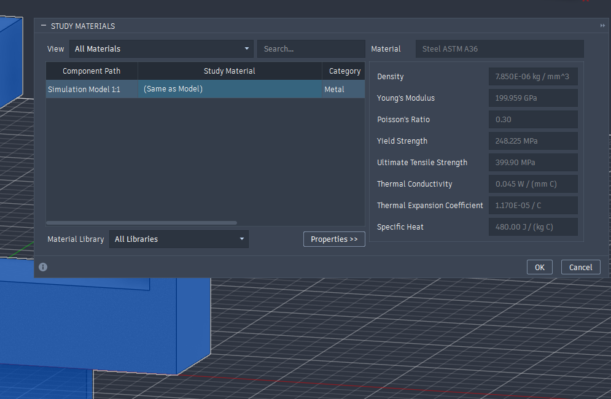

*Figure 1. Steel ASTM A36 material properties used in the simulation.*

### Bracket Boundary Conditions and Assumptions

A static stress study was used. The load was applied to the cylinder’s curved surface as an equivalent distributed force representing the two strap legs.

The two underside faces of the upper lips, which form the ceiling of the wide T-slot, were fixed in all three translation directions. This approximated the bracket being supported by the rigid T-beam.

The analysis used these assumptions:

- The material behaves as a homogeneous, isotropic, linear-elastic solid.
- The applied load is static.
- Fixed slot faces approximate the support from the T-beam.
- The distributed cylinder load approximates the strap loading without modeling the strap.
- The same material, total load, and intended support conditions are used for the three bracket designs.

The fixed support approximation does not model the actual sliding fit or contact movement against the T-beam. It can also affect stresses near the constrained faces. Results above yield indicate that the linear-elastic model does not describe the actual post-yield response.

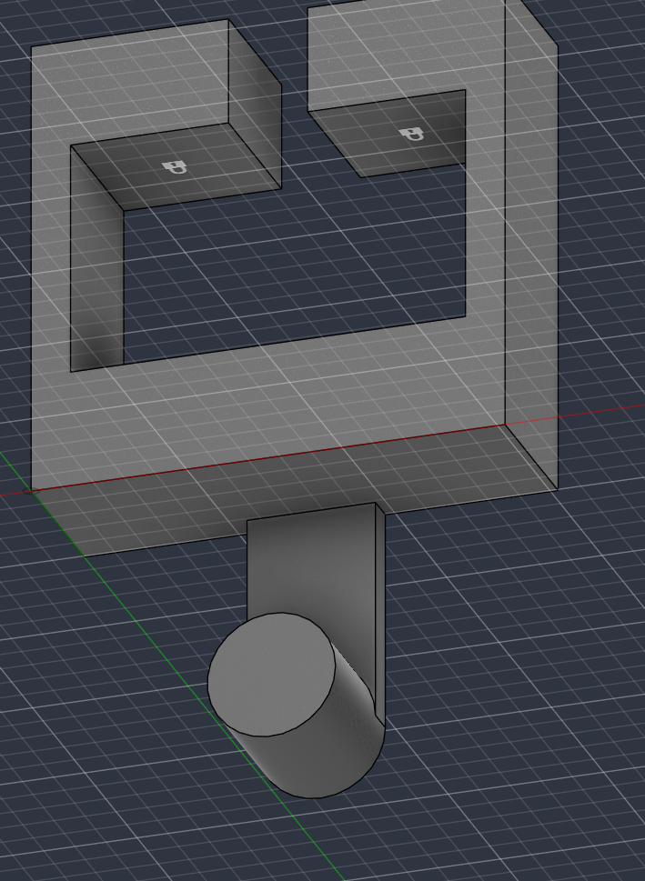

*Figure 2. Fixed constraint applied to the two supporting faces inside the bracket’s T-slot.*

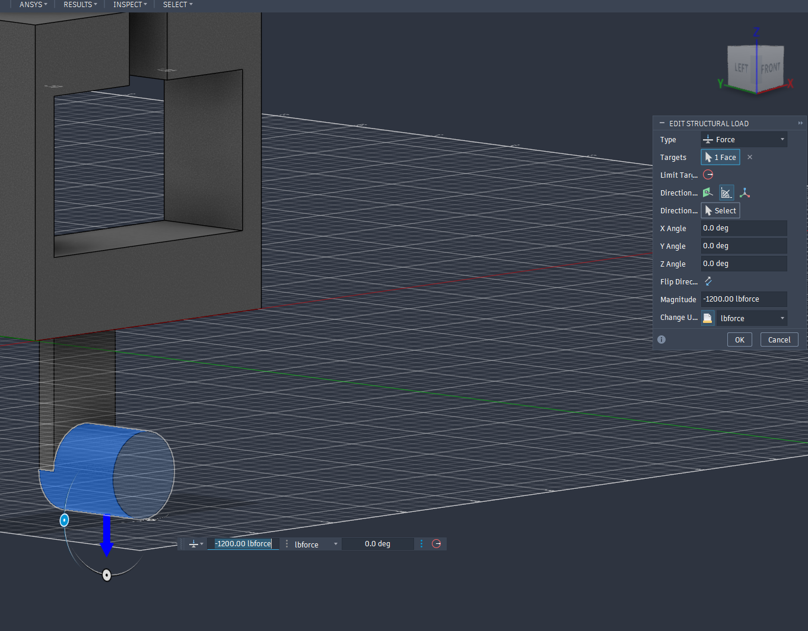

*Figure 3. A total downward load of 1,200 lbf applied to the bracket cylinder.*

### Mesh Convergence Method

The nominal absolute mesh sizes were 0.100 in, 0.075 in, and, when required, 0.050 in. Stress, displacement, and safety factor were compared between consecutive meshes.

Percentage change was calculated as:

Percentage change = absolute(new value - previous value) / previous value × 100

The convergence criterion was a change within 7% for all three results. A maximum of three mesh attempts was used for each design. When convergence was not achieved after the third mesh, the finest-mesh results were retained and the limitation was documented.

Displacements in the tables are rounded to the values displayed in Fusion. Identical displayed values do not necessarily mean the underlying results were exactly equal.

## Decide

### Bracket Design 1: Original Geometry

The original bracket was used as the baseline. Feature A was supported from the rear by feature B. The rear support thickness was 0.1875 in, and the exposed cylinder length was 0.750 in.

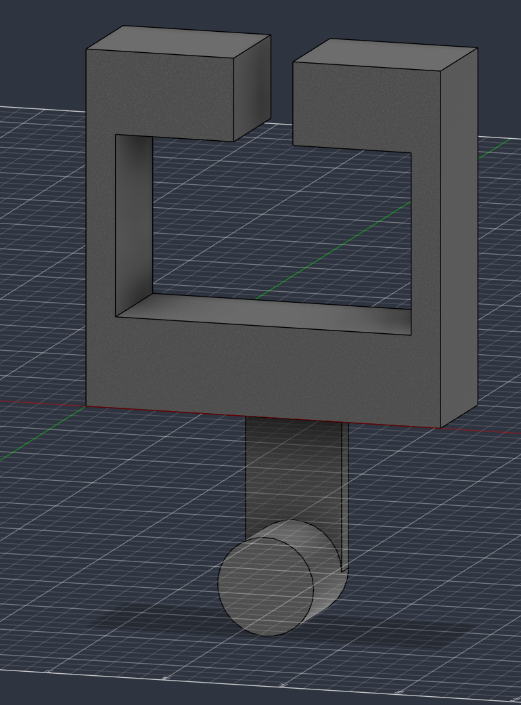

*Figure 4. Original bracket geometry with the cylinder supported by the rear member.*

| Mesh size (in) | Elements | Maximum von Mises stress (MPa) | Maximum displacement (mm) | Minimum safety factor |
|---|---:|---:|---:|---:|
| 0.100 | 26,313 | 976.993 | 1.795 | 0.254 |
| 0.075 | 59,556 | 1,041.902 | 1.800 | 0.238 |

Between the two meshes, stress changed by 6.64%, displacement by 0.28%, and safety factor by 6.30%. All three changes were within 7%, so the 0.075-in mesh was selected without a third mesh.

The high-stress region was near the rear support connection. Maximum displacement occurred near the free end of the cylinder.

The mass was 24.369 oz. The selected result had a safety factor of 0.238, which was below 4. The maximum displacement of 1.800 mm exceeded the 0.127-mm reference limit.

The original hand model treated feature B as axially loaded. The FEA includes the bending effect caused by the offset cylinder load, helping explain the difference between the hand analysis and simulation.

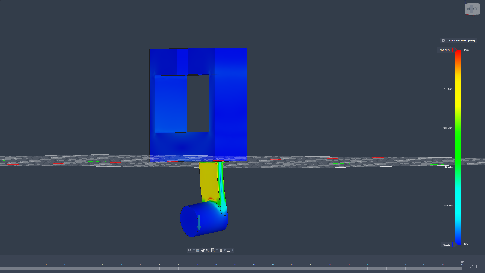

*Figure 5. Von Mises stress for Bracket Design 1 using the 0.100-in mesh.*

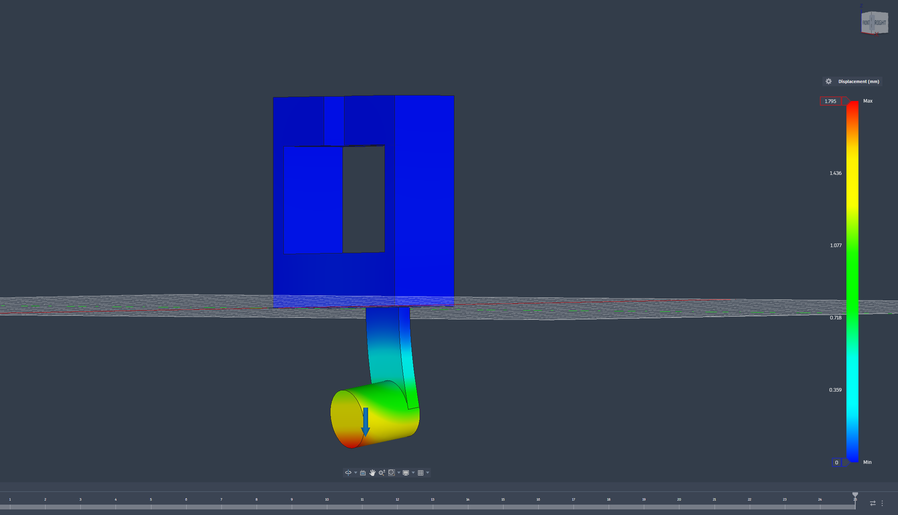

*Figure 6. Total displacement for Bracket Design 1 using the 0.100-in mesh.*

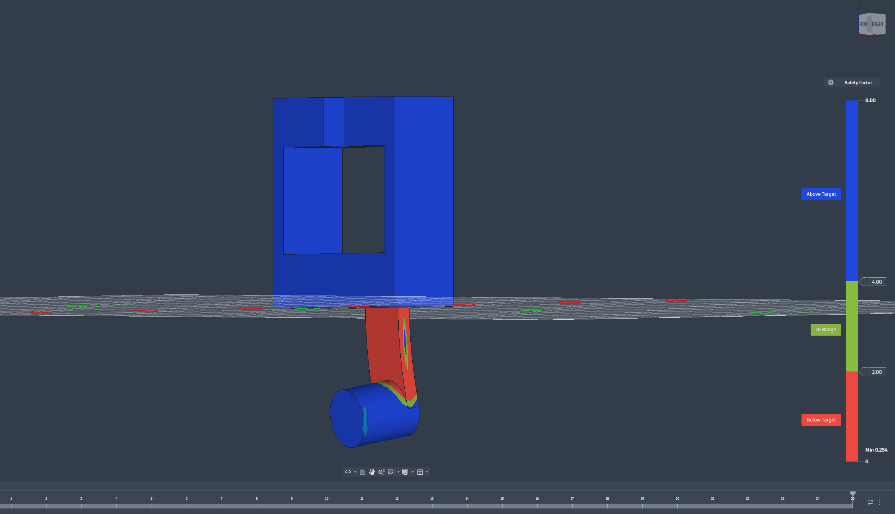

*Figure 7. Safety factor for Bracket Design 1 using the 0.100-in mesh.*

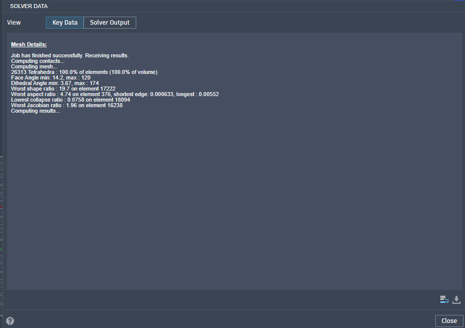

*Figure 8. Solver data and element count for Bracket Design 1 using the 0.100-in mesh.*

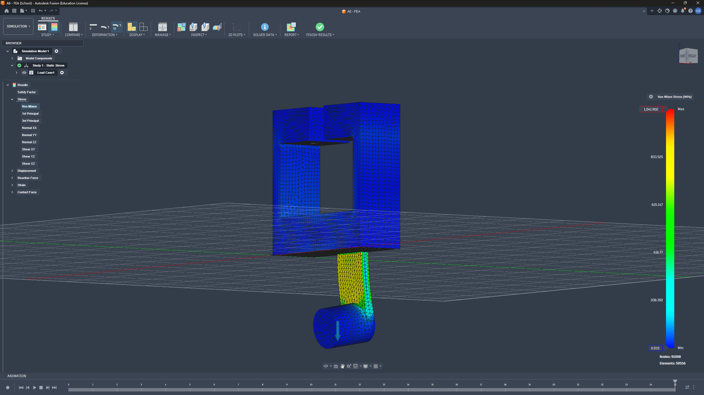

*Figure 9. Von Mises stress for Bracket Design 1 using the 0.075-in mesh.*

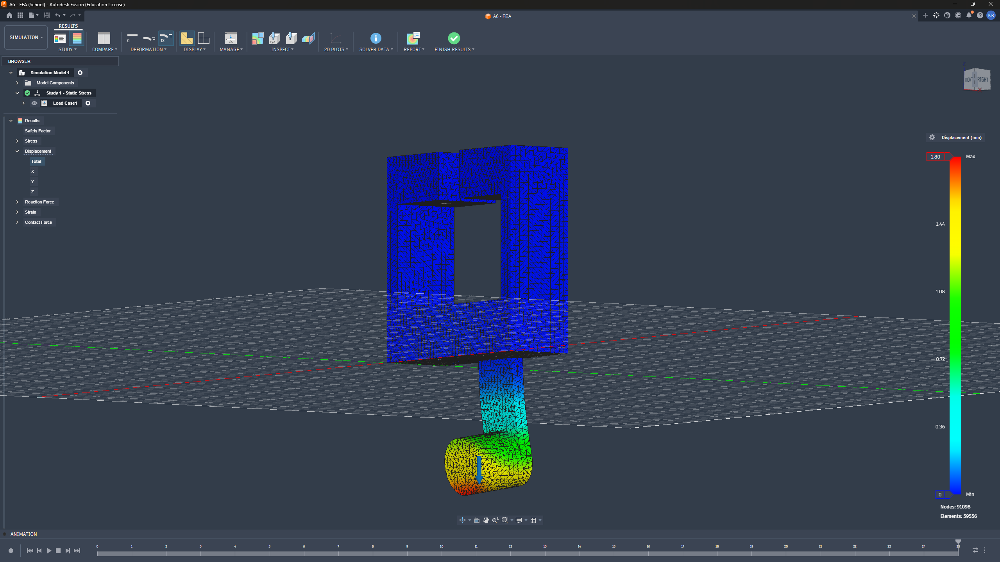

*Figure 10. Total displacement for Bracket Design 1 using the 0.075-in mesh.*

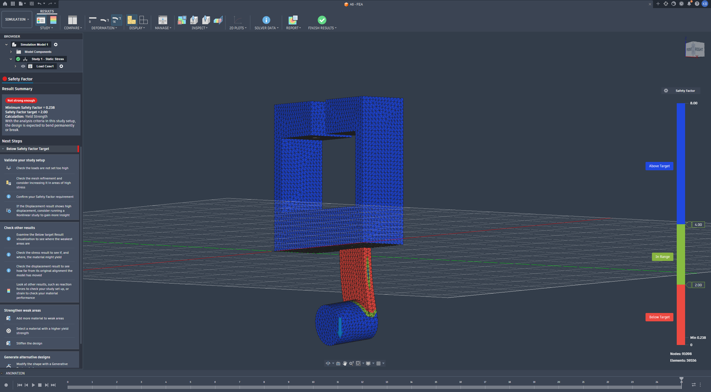

*Figure 11. Safety factor for Bracket Design 1 using the 0.075-in mesh.*

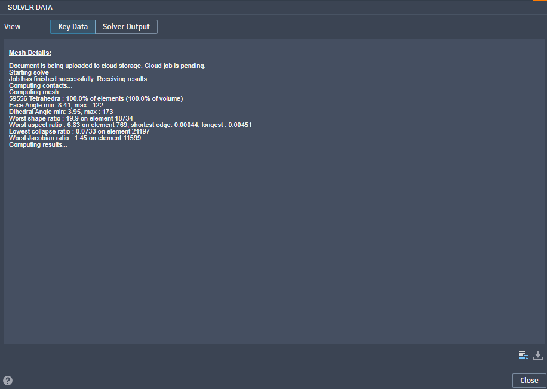

*Figure 12. Solver data and element count for Bracket Design 1 using the 0.075-in mesh.*

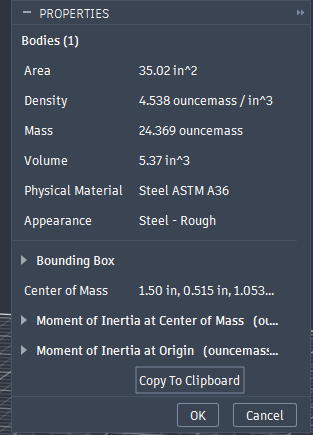

*Figure 13. Original bracket properties showing a mass of 24.369 oz.*

### Bracket Design 2: Thicker Rear Support

The rear support thickness was increased from 0.1875 in to 0.500 in to improve the support of the cylinder. The exposed cylinder length remained 0.750 in. Including the rear support thickness, the cylinder’s total length was 1.250 in.

The material, total applied force, and intended fixed support conditions were retained.

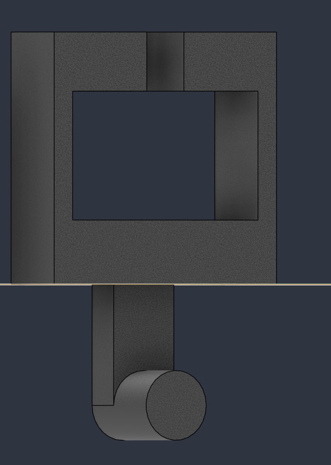

*Figure 14. Bracket Design 2 with the rear support thickness increased to 0.500 in.*

| Mesh size (in) | Elements | Maximum von Mises stress (MPa) | Maximum displacement (mm) | Minimum safety factor |
|---|---:|---:|---:|---:|
| 0.100 | 27,950 | 262.469 | 0.191 | 0.946 |
| 0.075 | 65,773 | 292.437 | 0.191 | 0.849 |
| 0.050 | 216,117 | 386.893 | 0.192 | 0.642 |

| Mesh comparison (in) | Stress change | Displacement change | Safety factor change |
|---|---:|---:|---:|
| 0.100 to 0.075 | 11.42% | 0.00% at displayed precision | 10.25% |
| 0.075 to 0.050 | 32.30% | 0.52% | 24.38% |

Stress and safety factor did not converge within 7% after three mesh attempts. The 0.050-in mesh was retained for reporting.

The high-stress region remained near the rear support’s connection to the upper block. The largest displacement occurred near the cylinder’s free end.

The thicker support substantially reduced stress and displacement compared with the original design. However, the reported minimum safety factor was still below 4, and the displacement of 0.192 mm exceeded the 0.127-mm reference limit.

The mass increased to 26.357 oz.

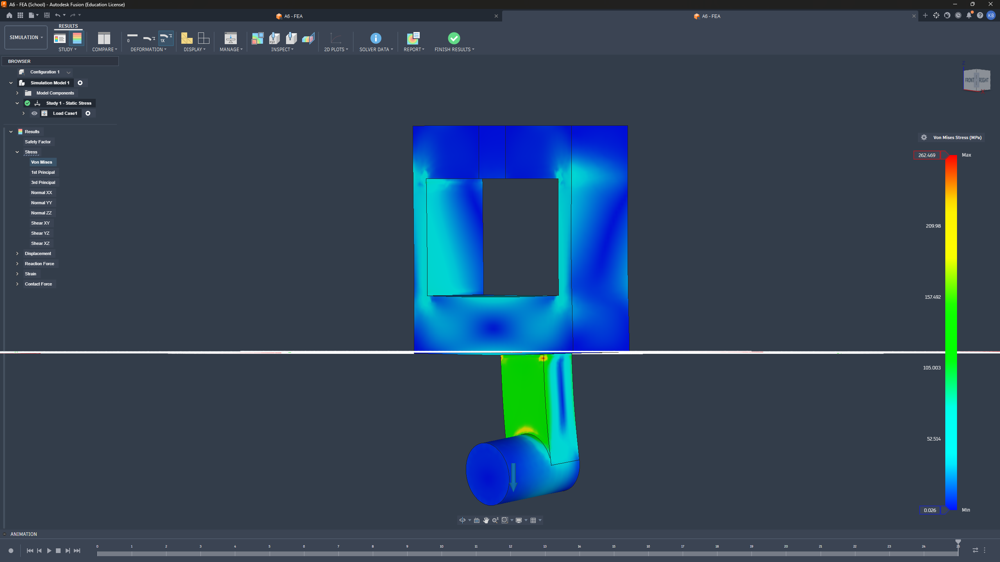

*Figure 15. Von Mises stress for Bracket Design 2 using the 0.100-in mesh.*

*Figure 16. Total displacement for Bracket Design 2 using the 0.100-in mesh.*

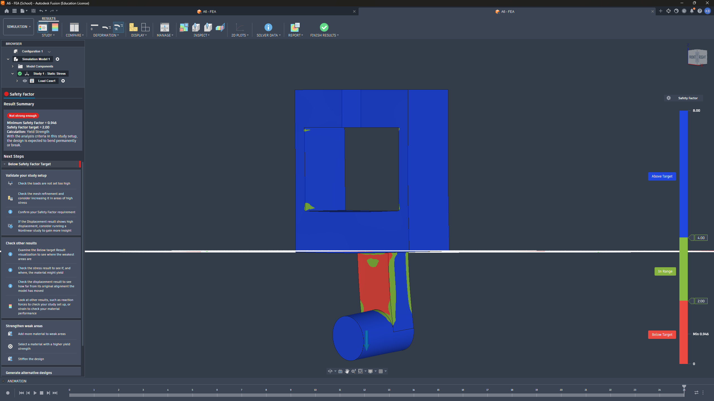

*Figure 17. Safety factor for Bracket Design 2 using the 0.100-in mesh.*

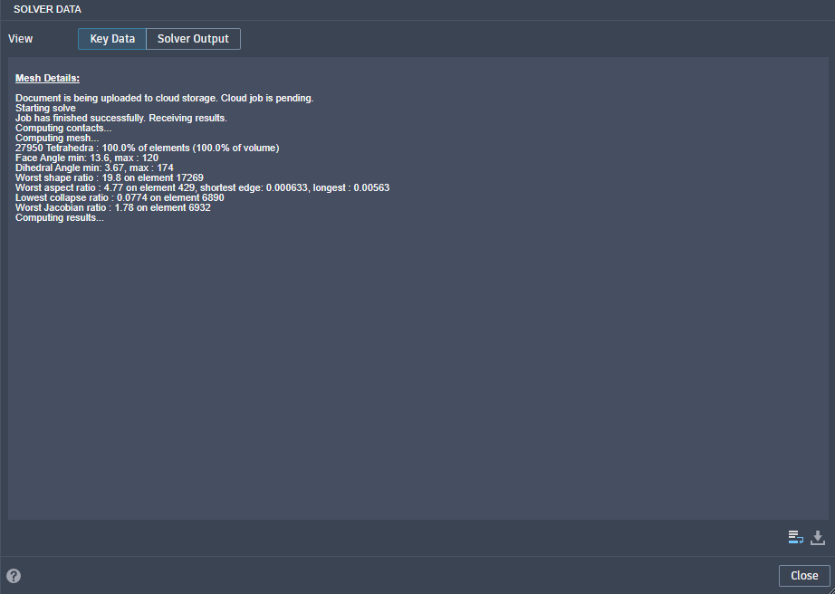

*Figure 18. Solver data and element count for Bracket Design 2 using the 0.100-in mesh.*

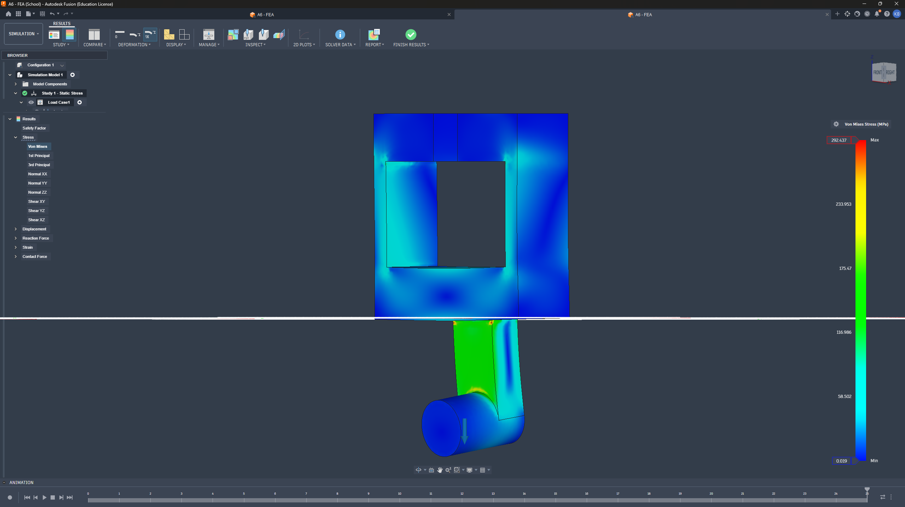

*Figure 19. Von Mises stress for Bracket Design 2 using the 0.075-in mesh.*

*Figure 20. Total displacement for Bracket Design 2 using the 0.075-in mesh.*

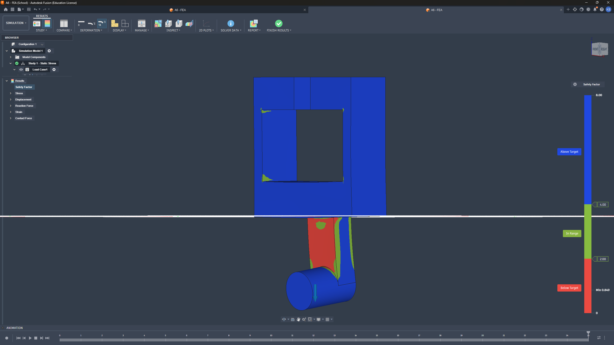

*Figure 21. Safety factor for Bracket Design 2 using the 0.075-in mesh.*

*Figure 22. Solver data and element count for Bracket Design 2 using the 0.075-in mesh.*

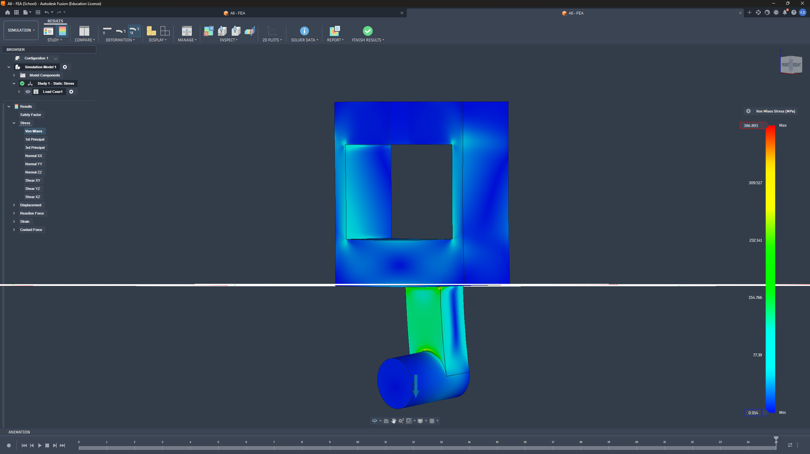

*Figure 23. Von Mises stress for Bracket Design 2 using the 0.050-in mesh.*

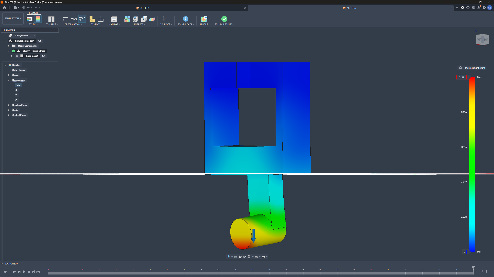

*Figure 24. Total displacement for Bracket Design 2 using the 0.050-in mesh.*

*Figure 25. Safety factor for Bracket Design 2 using the 0.050-in mesh.*

*Figure 26. Solver data and element count for Bracket Design 2 using the 0.050-in mesh.*

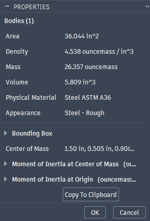

*Figure 27. Bracket Design 2 properties showing a mass of 26.357 oz.*

### Bracket Design 3: Added Front Support and Brace

A front support and diagonal brace were added to provide another load path from the cylinder to the upper block. The thicker rear support from Design 2 was retained. The front support thickness was 0.500 in, and the modeled gap between the supports was 0.752 in.

This modification was intended to reduce the bending associated with supporting the cylinder from only one end.

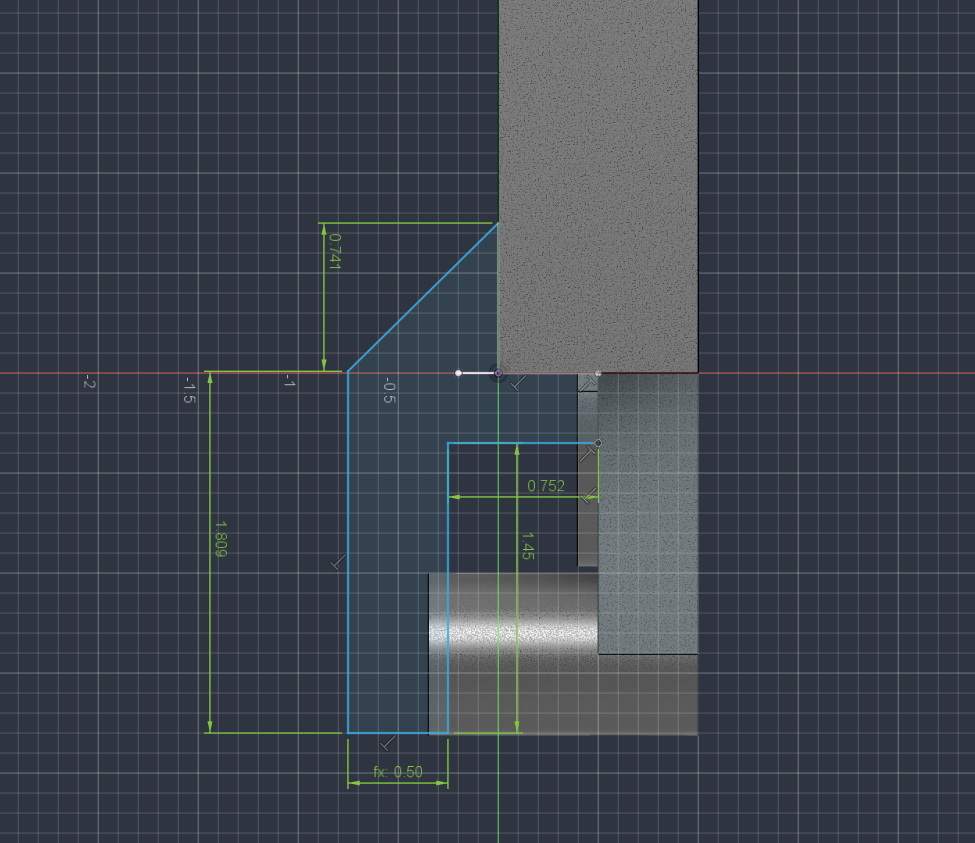

*Figure 28. Sketch defining the added front support and diagonal brace.*

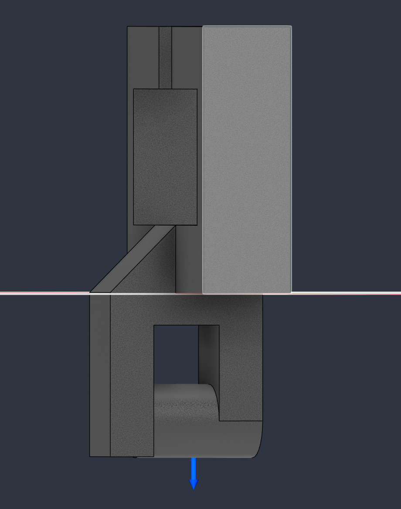

*Figure 29. Bracket Design 3 with the added front support and diagonal brace.*

| Mesh size (in) | Elements | Maximum von Mises stress (MPa) | Maximum displacement (mm) | Minimum safety factor |
|---|---:|---:|---:|---:|
| 0.100 | 38,140 | 95.391 | 0.061 | 2.602 |
| 0.075 | 86,918 | 110.196 | 0.061 | 2.253 |
| 0.050 | 270,592 | 152.315 | 0.062 | 1.630 |

| Mesh comparison (in) | Stress change | Displacement change | Safety factor change |
|---|---:|---:|---:|
| 0.100 to 0.075 | 15.52% | 0.00% at displayed precision | 13.41% |
| 0.075 to 0.050 | 38.22% | 1.64% | 27.65% |

Displacement stabilized, but stress and safety factor did not converge within 7% after three attempts. The 0.050-in mesh was retained.

High-stress regions appeared around the upper T-slot corners. The largest displacement appeared near the lower cylinder/front-support region. These locations are based on the contour plots; the exact maximum-stress node was not separately identified.

The displacement of 0.062 mm was below the original 0.127-mm feature limit. This global displacement comparison is a useful reference, but it does not separately verify each original feature’s relative deflection. The minimum safety factor of 1.630 was still below 4.

The mass increased to 31.701 oz.

The solver reported contact-segment warnings during Design 3. On the finest mesh, 140 segments were removed and 17 were converted in contact element 1. These warnings were not resolved during this iteration and remain a limitation of the reported results.

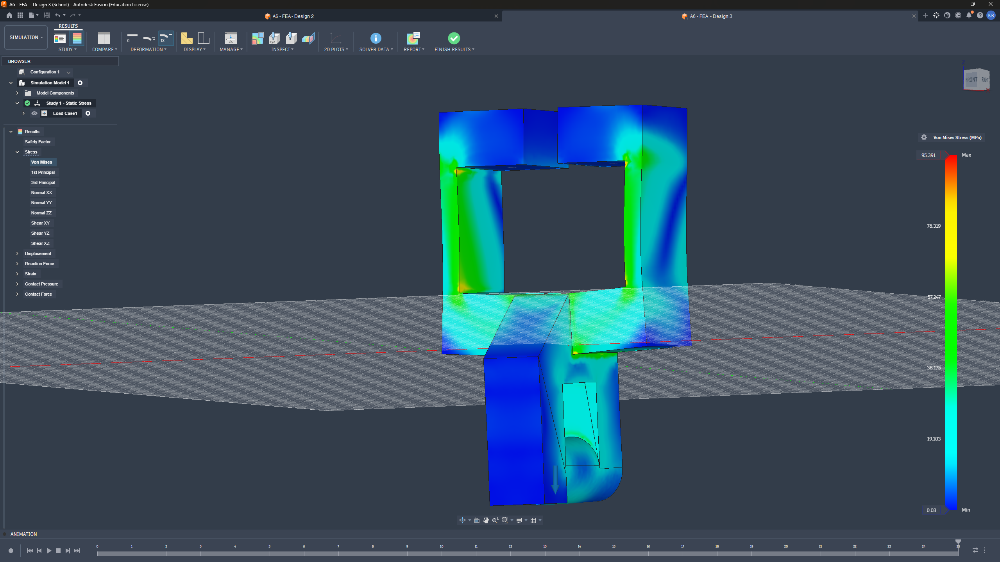

*Figure 30. Von Mises stress for Bracket Design 3 using the 0.100-in mesh.*

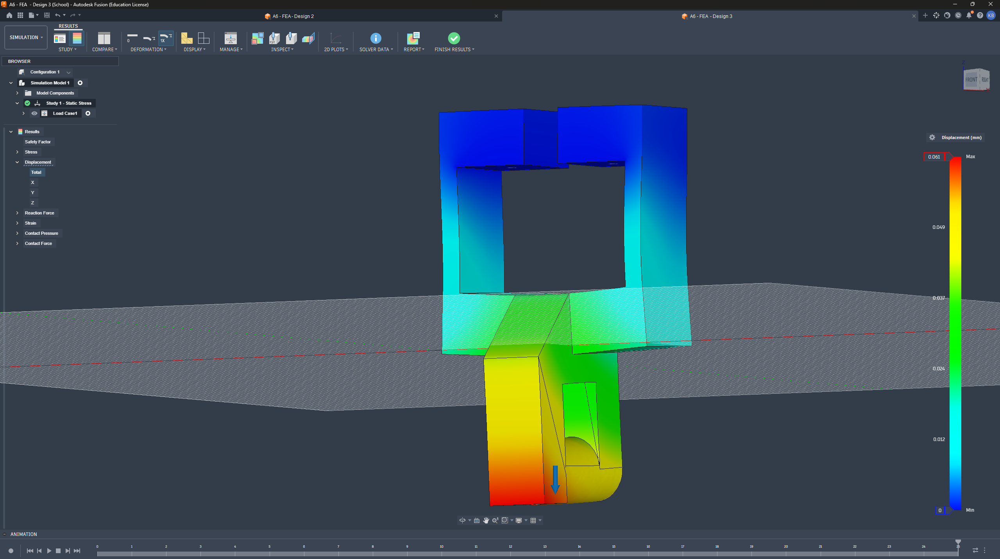

*Figure 31. Total displacement for Bracket Design 3 using the 0.100-in mesh.*

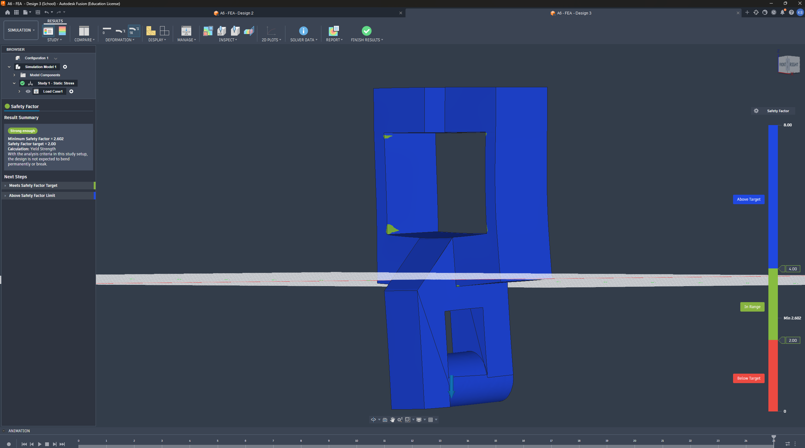

*Figure 32. Safety factor for Bracket Design 3 using the 0.100-in mesh.*

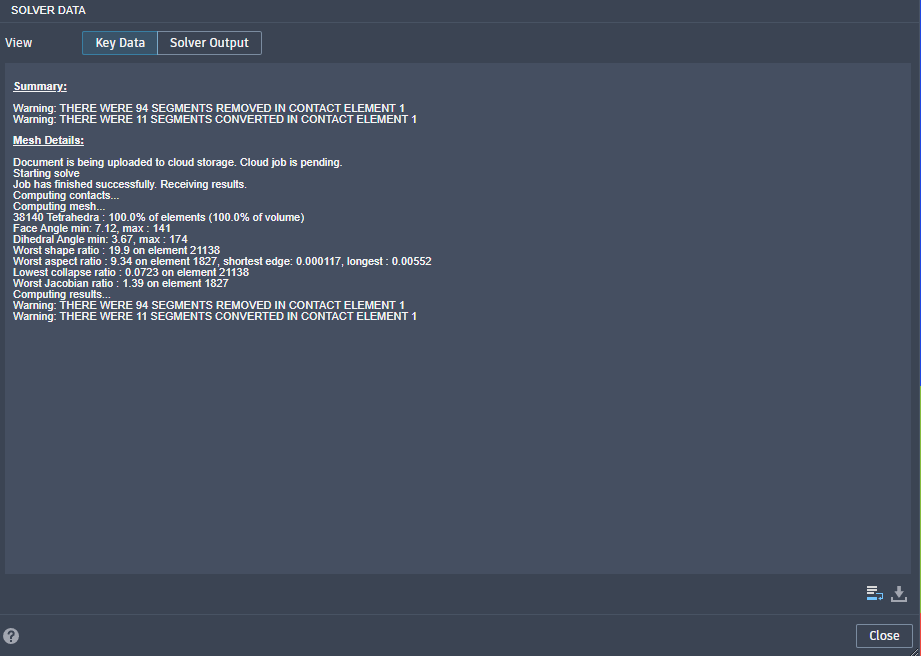

*Figure 33. Solver data and element count for Bracket Design 3 using the 0.100-in mesh.*

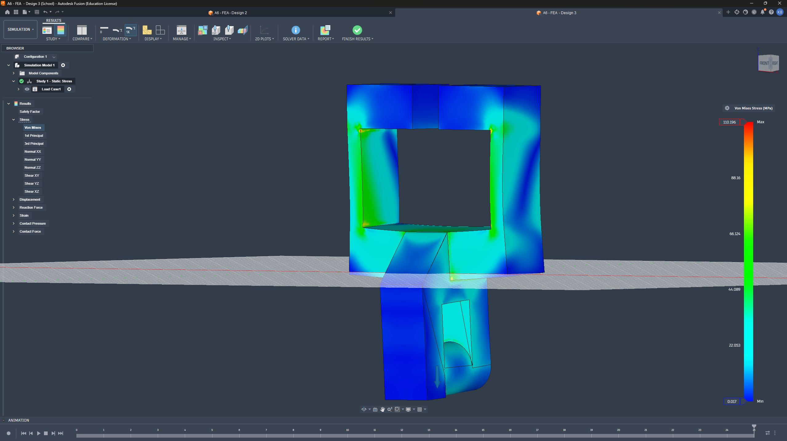

*Figure 34. Von Mises stress for Bracket Design 3 using the 0.075-in mesh.*

*Figure 35. Total displacement for Bracket Design 3 using the 0.075-in mesh.*

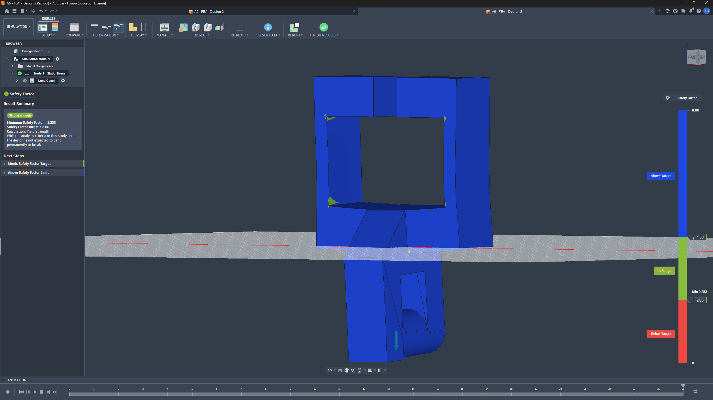

*Figure 36. Safety factor for Bracket Design 3 using the 0.075-in mesh.*

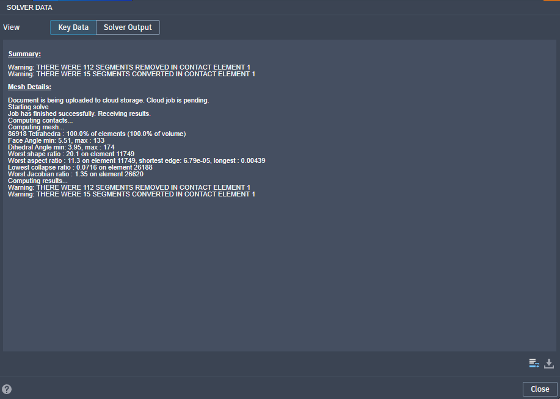

*Figure 37. Solver data and element count for Bracket Design 3 using the 0.075-in mesh.*

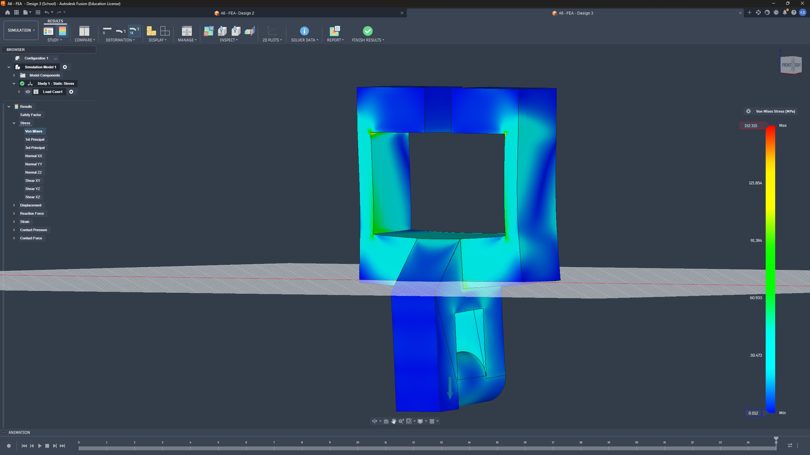

*Figure 38. Von Mises stress for Bracket Design 3 using the 0.050-in mesh.*

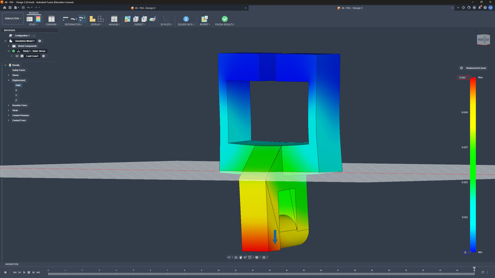

*Figure 39. Total displacement for Bracket Design 3 using the 0.050-in mesh.*

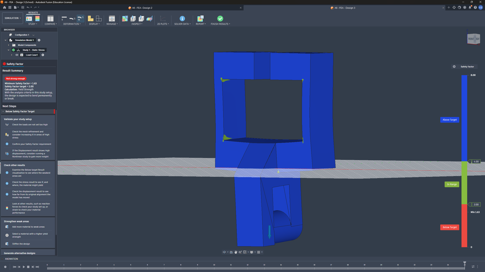

*Figure 40. Safety factor for Bracket Design 3 using the 0.050-in mesh.*

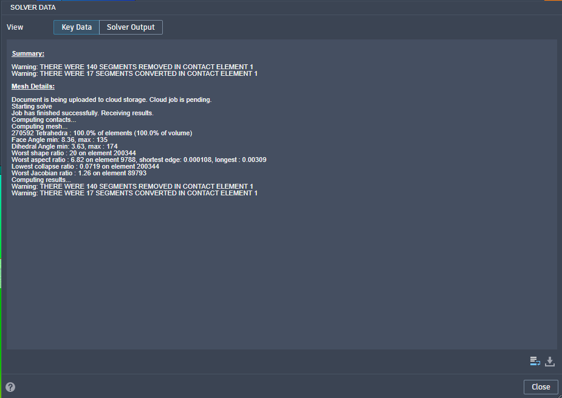

*Figure 41. Solver data and element count for Bracket Design 3 using the 0.050-in mesh.*

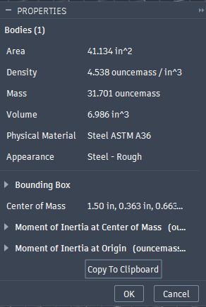

*Figure 42. Bracket Design 3 properties showing one body, Steel ASTM A36, and a mass of 31.701 oz.*

## Communicate

### Bracket Design Comparison

The following table uses the selected mesh for each design. Design 1 met the assignment’s convergence criterion. Designs 2 and 3 use their finest attempted mesh without stress convergence.

| Result | Design 1: Original | Design 2: Thicker rear support | Design 3: Added front support |
|---|---:|---:|---:|
| Selected mesh size (in) | 0.075 | 0.050 | 0.050 |
| Elements | 59,556 | 216,117 | 270,592 |
| Maximum stress (MPa) | 1,041.902 | 386.893 | 152.315 |
| Maximum displacement (mm) | 1.800 | 0.192 | 0.062 |
| Minimum safety factor | 0.238 | 0.642 | 1.630 |
| Mass (oz) | 24.369 | 26.357 | 31.701 |
| Convergence within 7% | Yes | No | No |
| Safety factor of at least 4 | No | No | No |

Design 3 gave the lowest reported stress and displacement and the highest safety factor among the three bracket designs. Compared with Design 1, its reported stress decreased by 85.38% and displacement decreased by 96.56%, while mass increased by 30.09%.

These comparisons show the benefit of the geometry changes within the modeled conditions. They do not establish that Design 3 meets all requirements because the safety factor remained below 4 and stress convergence was not achieved.

### Link Geometry and Study Setup

The original link was retained as the baseline for a separate static stress study.

- Material: Steel ASTM A36.
- Width: 1.750 in.
- Original thickness: 0.250 in.
- Hole center spacing: 2.000 in.
- Overall length: 3.750 in.
- Rounded end radius: 0.875 in.
- Smaller hole nominal diameter: 0.8125 in.
- Larger hole nominal diameter: 1.000 in.

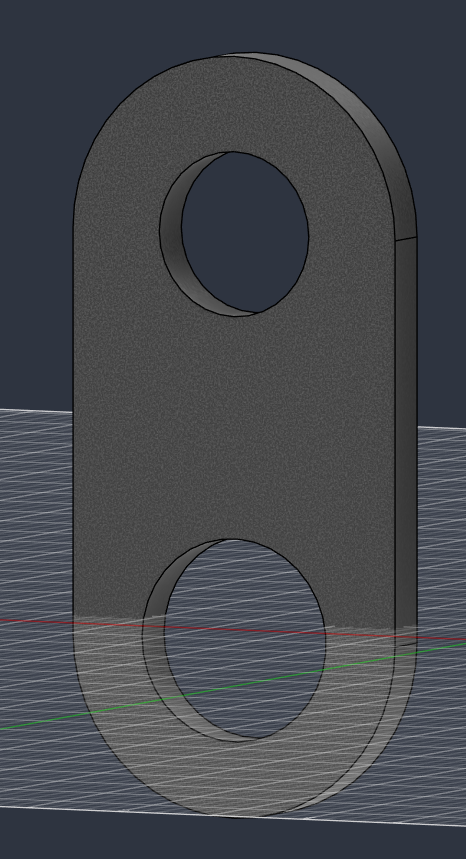

*Figure 43. Original link geometry used as the starting point for the link analysis.*

### Link Support and Loading Setup

The link setup uses a fixed constraint on the inside cylindrical surface of the larger, 1-inch hole. This approximates the shaft attachment as fully restrained. It does not calculate the pressure produced by the interference fit.

A bearing load of 1,200 lbf is specified on the inside cylindrical surface of the smaller hole. The load acts along the line joining the hole centers, away from the fixed hole, to place the link in tension.

For the modeled orientation with the smaller hole above the larger hole along positive Z, the specified components are:

- Fx = 0 lbf.
- Fy = 0 lbf.
- Fz = +1,200 lbf.

Each link design was solved using nominal mesh sizes of 0.100 in and 0.075 in. Material, hole sizes, hole spacing, width, loading, and support conditions were retained while thickness was changed.

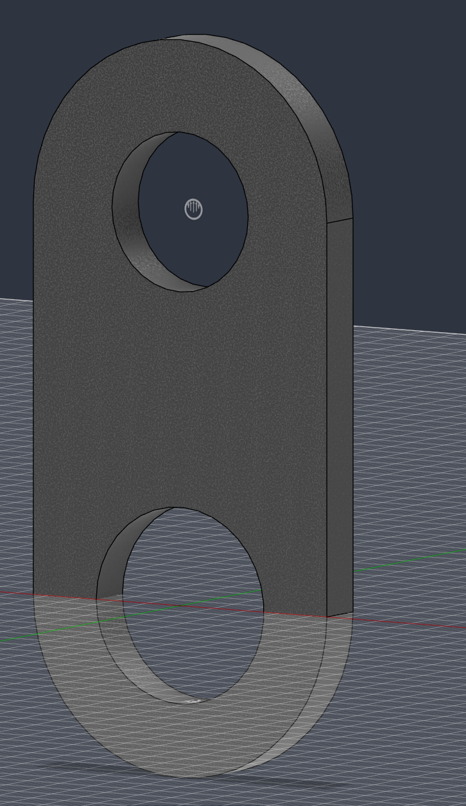

*Figure 44. Fixed constraint on the inside surface of the larger link hole.*

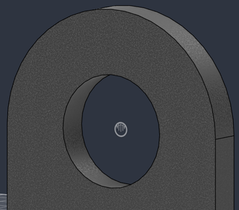

*Figure 45. A 1,200-lbf bearing load on the smaller link hole, directed away from the fixed hole.*

### Link Design 1: Original Geometry

The original 0.250-in thickness was evaluated first to establish the baseline.

| Mesh size (in) | Elements | Maximum von Mises stress (MPa) | Maximum displacement (mm) | Minimum safety factor |
|---|---:|---:|---:|---:|
| 0.100 | 5,784 | 148.474 | 0.017 | 1.672 |
| 0.075 | 15,138 | 145.970 | 0.017 | 1.700 |

Stress changed by 1.69%, displacement by 0.00% at displayed precision, and safety factor by 1.67%. All three changes were within 7%. The 0.075-in mesh was selected, and a third mesh was unnecessary.

The mass was 5.220 oz. The highest stress appeared on the upper inside surface of the smaller hole. Maximum displacement appeared in the material above that hole. These locations were identified from the contour plots.

The selected safety factor of 1.700 did not meet the target of 4. The maximum displacement of 0.017 mm was below 0.127 mm.

*Figure 46. Von Mises stress for Link Design 1 using the 0.100-in mesh.*

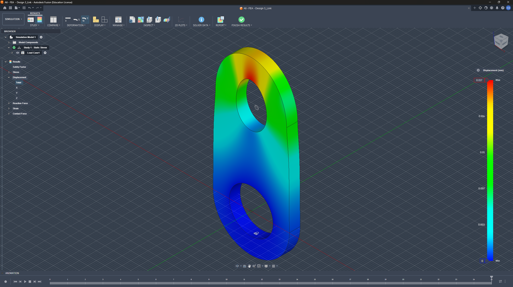

*Figure 47. Total displacement for Link Design 1 using the 0.100-in mesh.*

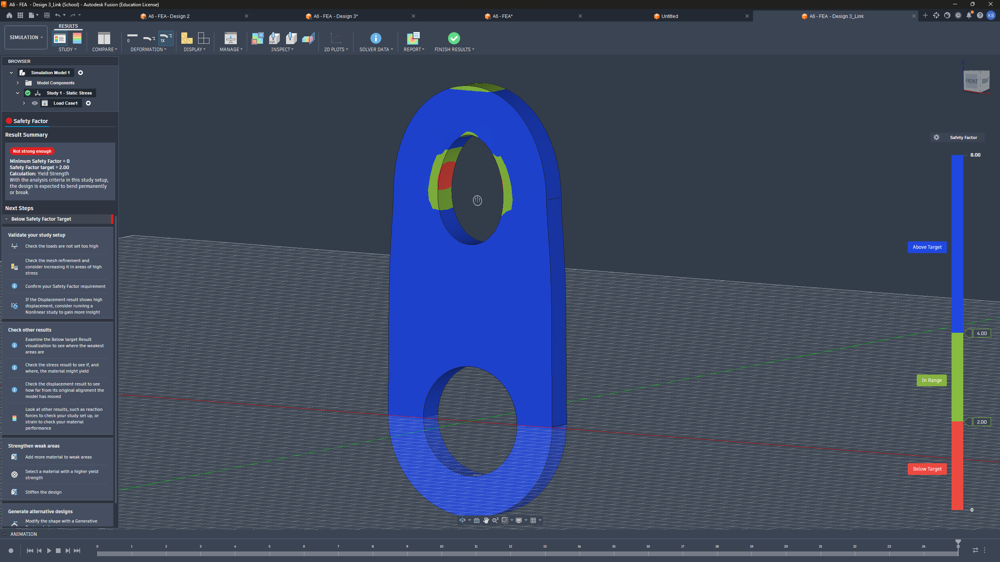

*Figure 48. Safety factor for Link Design 1 using the 0.100-in mesh.*

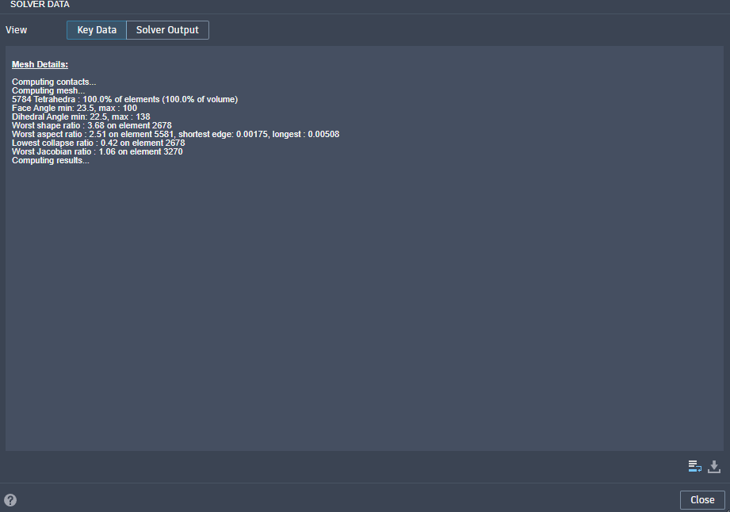

*Figure 49. Solver data and element count for Link Design 1 using the 0.100-in mesh.*

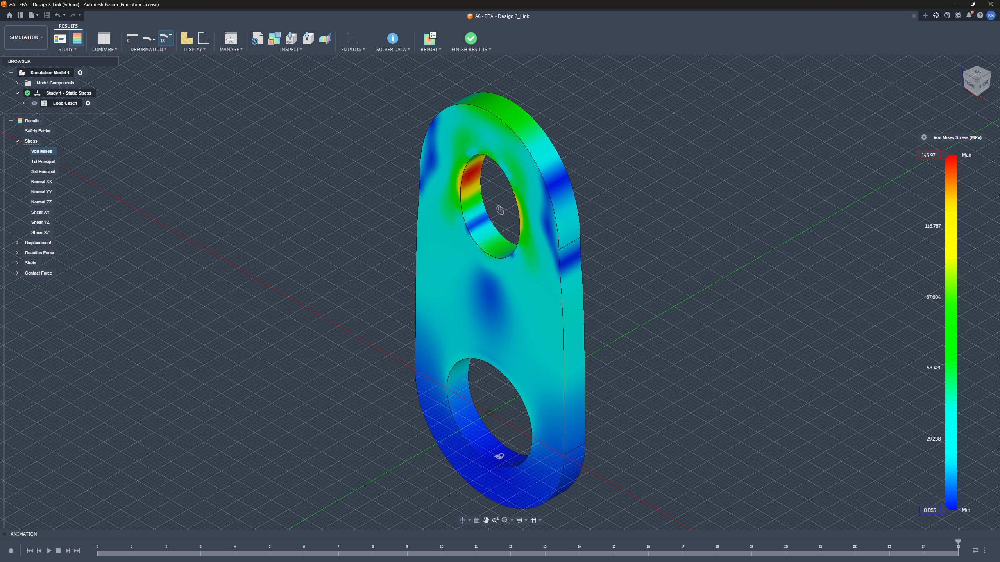

*Figure 50. Von Mises stress for Link Design 1 using the 0.075-in mesh.*

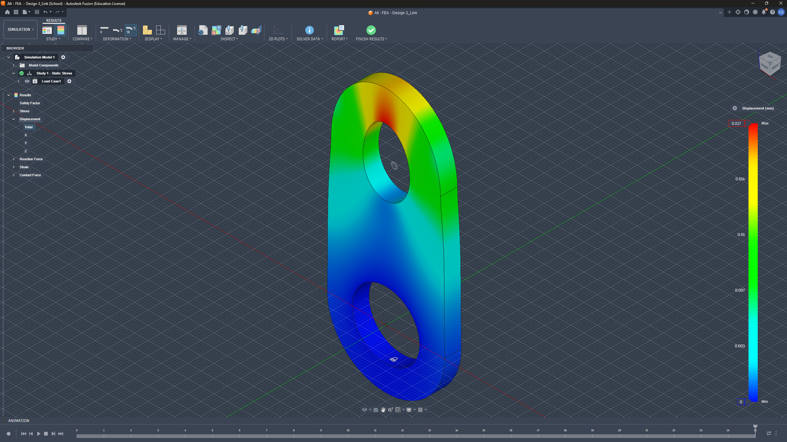

*Figure 51. Total displacement for Link Design 1 using the 0.075-in mesh.*

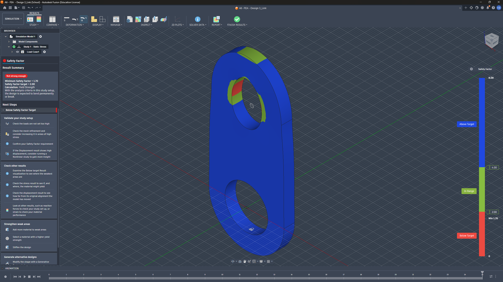

*Figure 52. Safety factor for Link Design 1 using the 0.075-in mesh.*

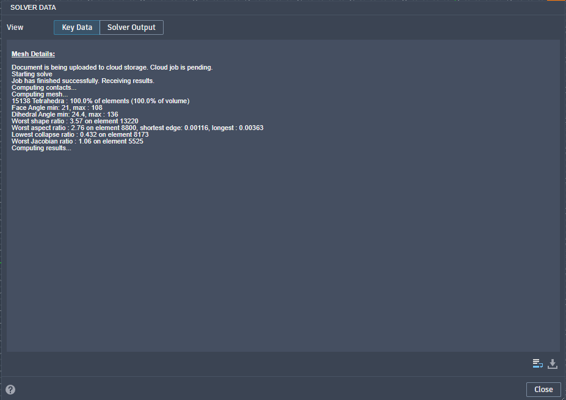

*Figure 53. Solver data and element count for Link Design 1 using the 0.075-in mesh.*

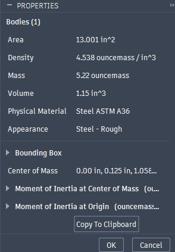

*Figure 54. Link Design 1 properties showing a mass of 5.220 oz.*

### Link Design 2: Increased Thickness to 0.500 in

The thickness was increased from 0.250 in to 0.500 in to reduce stress around the loaded hole. All other nominal dimensions were retained.

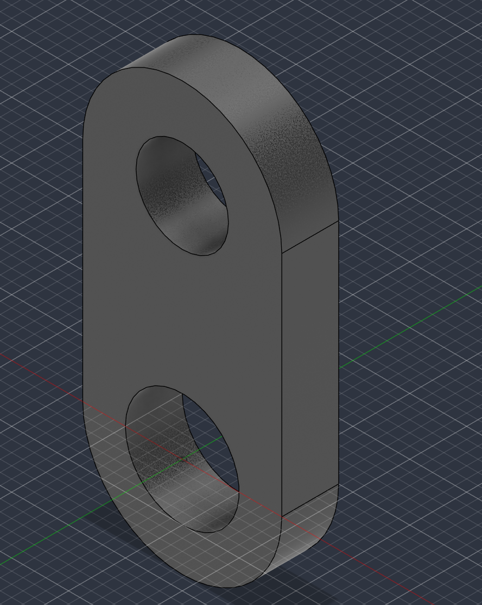

*Figure 55. Link Design 2 with a thickness of 0.500 in.*

| Mesh size (in) | Elements | Maximum von Mises stress (MPa) | Maximum displacement (mm) | Minimum safety factor |
|---|---:|---:|---:|---:|
| 0.100 | 14,460 | 72.865 | 0.009 | 3.407 |
| 0.075 | 30,276 | 71.986 | 0.009 | 3.448 |

Stress changed by 1.21%, displacement by 0.00% at displayed precision, and safety factor by 1.20%. All three changes were within 7%. The 0.075-in mesh was selected, and a third mesh was unnecessary.

The mass was 10.440 oz. The highest stress appeared on the upper inside surface of the smaller hole. Maximum displacement appeared in the material above that hole.

The selected safety factor of 3.448 did not meet the target of 4. The maximum displacement of 0.009 mm was below 0.127 mm.

*Figure 56. Von Mises stress for Link Design 2 using the 0.100-in mesh.*

*Figure 57. Total displacement for Link Design 2 using the 0.100-in mesh.*

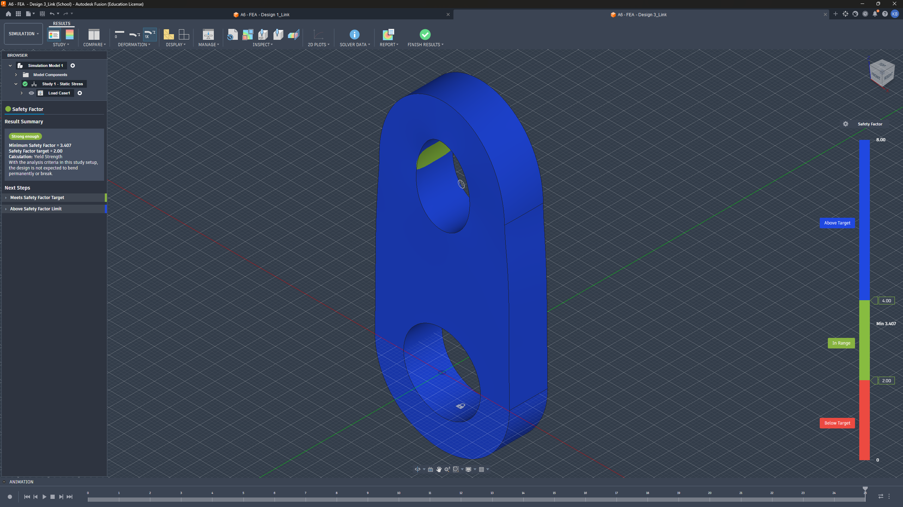

*Figure 58. Safety factor for Link Design 2 using the 0.100-in mesh.*

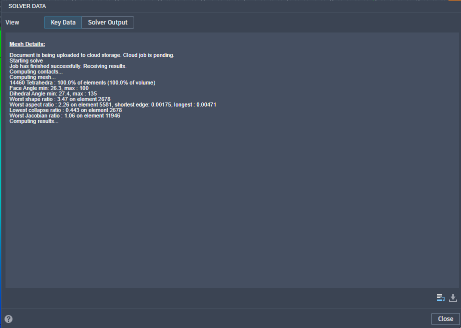

*Figure 59. Solver data and element count for Link Design 2 using the 0.100-in mesh.*

*Figure 60. Von Mises stress for Link Design 2 using the 0.075-in mesh.*

*Figure 61. Total displacement for Link Design 2 using the 0.075-in mesh.*

*Figure 62. Safety factor for Link Design 2 using the 0.075-in mesh.*

*Figure 63. Solver data and element count for Link Design 2 using the 0.075-in mesh.*

*Figure 64. Link Design 2 properties showing a mass of 10.440 oz.*

### Link Design 3: Increased Thickness to 0.625 in

The thickness was increased from 0.500 in to 0.625 in to further reduce stress around the loaded hole. All other nominal dimensions were retained.

*Figure 65. Link Design 3 with a thickness of 0.625 in.*

| Mesh size (in) | Elements | Maximum von Mises stress (MPa) | Maximum displacement (mm) | Minimum safety factor |
|---|---:|---:|---:|---:|
| 0.100 | 17,352 | 57.759 | 0.007 | 4.298 |
| 0.075 | 40,368 | 56.998 | 0.007 | 4.355 |

Stress changed by 1.32%, displacement by 0.00% at displayed precision, and safety factor by 1.33%. All three changes were within 7%. The 0.075-in mesh was selected, and a third mesh was unnecessary.

The mass was 13.050 oz. The highest stress appeared on the upper inside surface of the smaller hole. Maximum displacement appeared in the material above that hole.

The selected safety factor of 4.355 met the target of 4. The maximum displacement of 0.007 mm was below 0.127 mm.

*Figure 66. Von Mises stress for Link Design 3 using the 0.100-in mesh.*

*Figure 67. Total displacement for Link Design 3 using the 0.100-in mesh.*

*Figure 68. Safety factor for Link Design 3 using the 0.100-in mesh.*

*Figure 69. Solver data and element count for Link Design 3 using the 0.100-in mesh.*

*Figure 70. Von Mises stress for Link Design 3 using the 0.075-in mesh.*

*Figure 71. Total displacement for Link Design 3 using the 0.075-in mesh.*

*Figure 72. Safety factor for Link Design 3 using the 0.075-in mesh.*

*Figure 73. Solver data and element count for Link Design 3 using the 0.075-in mesh.*

*Figure 74. Link Design 3 properties showing a mass of 13.050 oz.*

### Final Link Comparison

All three link designs met the 7% convergence criterion. The table uses the selected 0.075-in mesh results.

| Result | Design 1 | Design 2 | Design 3 |
|---|---:|---:|---:|
| Thickness (in) | 0.250 | 0.500 | 0.625 |
| Elements | 15,138 | 30,276 | 40,368 |
| Maximum stress (MPa) | 145.970 | 71.986 | 56.998 |
| Maximum displacement (mm) | 0.017 | 0.009 | 0.007 |
| Minimum safety factor | 1.700 | 3.448 | 4.355 |
| Mass (oz) | 5.220 | 10.440 | 13.050 |
| Convergence within 7% | Yes | Yes | Yes |
| Safety factor at least 4 | No | No | Yes |

Link Design 3 was selected because it was the only tested link design that met the safety factor target of 4.

Increasing thickness reduced stress and displacement but increased mass. Compared with Design 1, Design 3 reduced peak stress by 60.95% and displayed maximum displacement by 58.82%, while increasing mass by 150.00%.

The final link dimensions were:

- Width: 1.750 in.
- Overall length: 3.750 in.
- Thickness: 0.625 in.
- Hole center spacing: 2.000 in.
- Rounded end radius: 0.875 in.
- Smaller hole nominal diameter: 0.8125 in.
- Larger hole nominal diameter: 1.000 in.

Strength governed the link modification. Design 1 already had a displacement below 0.127 mm, but its safety factor was only 1.700. The increased thickness was needed to meet the strength target.

### Overall Design Decision

Bracket Design 3 provided the best reported bracket performance, but its minimum safety factor of 1.630 remained below 4, and peak stress did not converge.

Link Design 3 met the modeled strength target with a minimum safety factor of 4.355 and converged within the assignment criterion.

These separate studies do not establish that the entire bracket/link assembly meets every requirement.

## Lessons Learned

### Geometry and Load Path

Increasing the rear support thickness improved the bracket response. Adding a front support and brace produced a larger improvement by changing how the cylinder load was transferred into the upper block. The improvement came with increased mass.

### Hand Analysis and FEA

The original axial model of feature B did not account for the bending produced by the offset cylinder load. The FEA showed why the assumptions used in a hand calculation must match the geometry and load path.

### Mesh Sensitivity

A stable displacement result does not guarantee stable peak stress. Bracket Designs 2 and 3 showed small displacement changes while the reported peak stress increased substantially with mesh refinement.

Sharp corners and constrained regions may contribute to this sensitivity, but the available results do not establish the exact cause.

All three link designs met the convergence criterion after two mesh attempts.

### Requirement Check

A higher safety factor is an improvement, but it is not automatically a passing result. Bracket Design 3 improved to 1.630, which still did not meet the required value of 4.

The final link safety factor of 4.355 met the modeled strength target.

### Link Thickness and Strength

Increasing link thickness from 0.250 in to 0.625 in increased the minimum safety factor from 1.700 to 4.355.

The original displacement was already small, so strength controlled the modification. The improvement required an increase in mass from 5.220 oz to 13.050 oz.

### Modeling Limitations

Fixed supports simplify the actual fits and contact behavior. The link study did not calculate interference-fit pressure.

The unresolved contact warnings in Bracket Design 3 also limit confidence in its results. These limitations must remain visible when presenting the design comparison.

## Time Spent
Original bracket study setup and analysis: 45 minutes
Bracket Design 2 geometry change and mesh studies: 1 hour
Bracket Design 3 geometry change and mesh studies: 1 hour
Link Design 1 setup and mesh studies: 30 minutes
Link Design 2 thickness change and mesh studies: 45 minutes
Link Design 3 thickness change and mesh studies: 45 minutes
Portfolio documentation: 6 hours
Total: 10 hours 45 minutes

## Downloadable Files

- [Bracket Design 1 CAD file](A6-FEA.f3z)
- [Bracket Design 2 CAD file](A6-FEA-Design2.f3z)
- [Bracket Design 3 CAD file](A6-FEA-Design3.f3z)
- [Link Design 1 CAD file](A6-FEA-Design1_Link.f3z)
- [Link Design 2 CAD file](A6-FEA-Design2_Link.f3z)
- [Link Design 3 CAD file](A6-FEA-Design3_Link.f3z)

## References

- MEGR 2157 assignment instructions: bracket/link finite element analysis, mesh convergence, and geometry improvement.
- Previous bracket and link design calculations and drawings.
- Autodesk Fusion material library: Steel ASTM A36 properties used in the studies.
- [Autodesk Fusion: Set up a Static Stress analysis](https://help.autodesk.com/view/fusion360/ENU/?contextId=SIM-SSA).
- [Autodesk Fusion: Bearing loads in the Simulation workspace](https://help.autodesk.com/cloudhelp/ENU/Fusion-Simulate/files/SIM-BEARING-LOAD-CONCEPT.htm).
- [Autodesk Fusion: Fixed constraint](https://help.autodesk.com/cloudhelp/ENU/Fusion-Simulate/files/SIM-FIXED-CONSTRAINT.htm).
