# A8 — Gearbox Design

**Course:** MEGR 2156 / MEGR 2157  

## Objective

The objective of this assignment was to design a functional gearbox that could be assembled and disassembled. The project required analyzing the strength of the input and output shafts, selecting journal bearings, designing a two-component housing, and creating a complete parametric CAD assembly in Fusion 360.

The gearbox uses two meshing spur gears to reduce rotational speed while increasing output torque.

The project included:

- Input and output shaft stress analysis
- Journal bearing pressure, velocity, and PV calculations
- Journal bearing wall thickness analysis
- Selection of commercially available components
- Two-component gearbox housing design
- Parametric CAD modeling in Fusion 360
- Assembly joints and gear motion relationships
- Six individual component drawings
- One complete assembly drawing
- Documentation of design decisions and lessons learned

---

# 1. Analyze — Initial Design Requirements

## 1.1 Given Information

The assignment provided the following specifications:

- Gear ratio: 24:9
- Output torque: 1.25 lbf-in
- Output speed: 1100 rpm
- Input shaft diameter: 0.125 in
- Output shaft diameter: 0.250 in
- Input shaft length: 1.000 in
- Output shaft length: 1.000 in
- Ideal gear train
- Negligible bending moment from the radial gear force
- Press-fit gear-to-shaft connections
- Running fits between shafts and journal bearings

## 1.2 Gear Selection

Two commercially available brass spur gears were selected for the gearbox.

### Input Pinion

McMaster-Carr Part Number: 7880K19

- Number of teeth: 18
- Diametral pitch: 48
- Pitch diameter: 0.375 in
- Outside diameter: 0.420 in
- Bore diameter: 0.125 in
- Face width: 0.125 in
- Material: Brass

### Output Gear

McMaster-Carr Part Number: 7880K24

- Number of teeth: 48
- Diametral pitch: 48
- Pitch diameter: 1.000 in
- Outside diameter: 1.040 in
- Bore diameter: 0.250 in
- Face width: 0.125 in
- Material: Brass

The gears contain 18 and 48 teeth, producing the same reduction ratio as the 24:9 ratio specified in the assignment.

**Calculated gear ratio:** 2.66667:1

**Calculated gear center distance:** 0.68750 in

## 1.3 Initial Power and Torque Calculations

The gear ratio and ideal power transmission equations were used to determine the operating conditions of the input and output shafts.

Calculated values:

- Input speed: 2933.333 rpm
- Output speed: 1100 rpm
- Input torque: 0.46875 lbf-in
- Output torque: 1.25000 lbf-in
- Input power: 0.021817 hp
- Output power: 0.021817 hp

The input and output powers were considered equal because the gear train was assumed to be ideal.

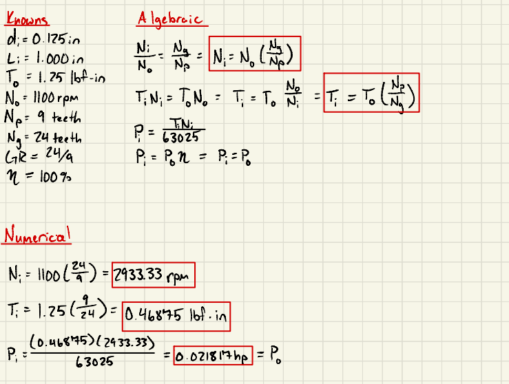

---

# 2. Analyze — Input Shaft Design

## 2.1 Known Values

The input shaft transfers power from the external motor to the smaller spur gear.

Known values:

- Shaft diameter: 0.125 in
- Shaft length: 1.000 in
- Input torque: 0.46875 lbf-in
- Input speed: 2933.333 rpm
- Material: AISI 1018 cold-drawn steel
- Assumed yield strength: 53,700 psi
- Required factor of safety: 2.0

The unknowns included maximum shear stress, polar moment of inertia, von Mises equivalent stress, actual factor of safety, and minimum required diameter.

## 2.2 Free-Body Diagram

The input shaft experiences an applied torque from the motor and an opposing torque from the pinion gear.

The shaft was initially analyzed under pure torsion.

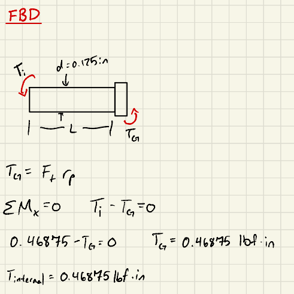

*Figure 1: Free-body diagram showing the applied and resisting torques acting on the input shaft.*

## 2.3 Symbolic Analysis

The shaft was modeled using the torsion equations for a solid circular shaft.

The analysis included:

- Polar moment of inertia
- Maximum torsional shear stress
- Von Mises equivalent stress
- Allowable shear stress
- Actual factor of safety
- Minimum required shaft diameter

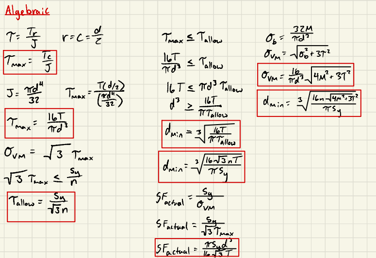

*Figure 2: Symbolic derivation of the input shaft stress equations.*

## 2.4 Numerical Results

Calculated values:

- Polar moment of inertia: 0.00002396845 in^4
- Maximum torsional shear stress: 1222.31 psi
- Von Mises equivalent stress: 2117.10 psi
- Allowable shear stress: 15501.85 psi
- Minimum required diameter: 0.053601 in
- Actual factor of safety: 25.365

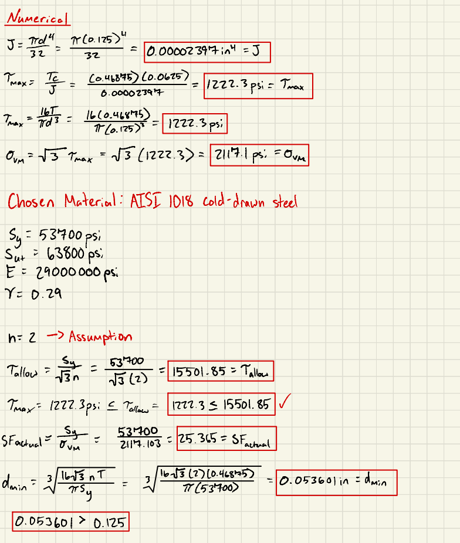

*Figure 3: Numerical stress calculations and minimum diameter determination for the input shaft.*

## 2.5 Decide — Input Shaft Diameter

The calculated minimum diameter was 0.053601 inches, while the specified shaft diameter was 0.125 inches.

The actual factor of safety under pure torsion was calculated to be 25.365, which exceeds the required factor of safety of 2.0.

**Decision: Retain the original 0.125-inch input shaft diameter.**

The existing shaft is sufficient for the preliminary pure-torsion analysis. Additional considerations include bending, press-fit stresses, stress concentrations, and fatigue.

---

# 3. Analyze — Output Shaft Design

## 3.1 Known Values

The output shaft transfers torque from the larger spur gear to the external load.

Known values:

- Shaft diameter: 0.250 in
- Shaft length: 1.000 in
- Output torque: 1.25000 lbf-in
- Output speed: 1100 rpm
- Material: AISI 1018 cold-drawn steel
- Assumed yield strength: 53,700 psi
- Required factor of safety: 2.0

## 3.2 Free-Body Diagram

The output shaft experiences torque transmitted through the larger gear and an opposing torque from the connected load.

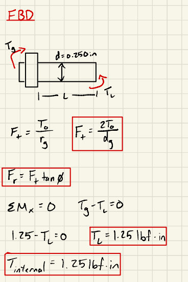

*Figure 4: Free-body diagram showing the torques acting on the output shaft.*

## 3.3 Symbolic Analysis

The same torsional stress equations used for the input shaft were applied to the output shaft.

The analysis determined the polar moment of inertia, shear stress, equivalent stress, factor of safety, and minimum required diameter.

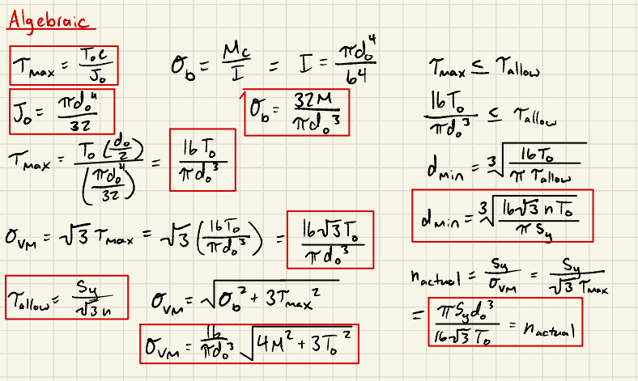

*Figure 5: Symbolic calculations for the output shaft.*

## 3.4 Numerical Results

Calculated values:

- Polar moment of inertia: 0.00038349520 in^4
- Maximum torsional shear stress: 407.437 psi
- Von Mises equivalent stress: 705.701 psi
- Allowable shear stress: 15501.85 psi
- Minimum required diameter: 0.074330 in
- Actual factor of safety: 76.095

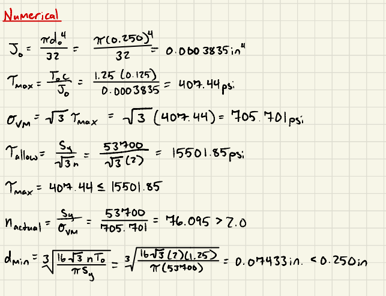

*Figure 6: Numerical stress calculations and minimum diameter determination for the output shaft.*

## 3.5 Decide — Output Shaft Diameter

The minimum required shaft diameter was calculated to be 0.074330 inches, which is smaller than the existing 0.250-inch diameter.

The actual factor of safety under pure torsion was calculated to be 76.095.

**Decision: Retain the original 0.250-inch output shaft diameter.**

Although the stress calculation indicates that a smaller shaft could withstand the torque, the specified diameter provides compatibility with the selected gear and journal bearings.

---

# 4. Analyze — Journal Bearing Design

## 4.1 Purpose of the Journal Bearings

Journal bearings support the rotating input and output shafts while reducing friction between the shafts and stationary gearbox housing.

The selected design uses two sleeve bearings per shaft, with the gears positioned between the bearing supports.

This arrangement provides support on both sides of the gears and allows the bearing loads to be calculated using static equilibrium.

## 4.2 Gear Force Calculations

The gear tooth forces were calculated using the input torque, pinion pitch diameter, and 20-degree pressure angle.

Calculated values:

- Tangential gear force: 2.50000 lbf
- Radial gear force: 0.90993 lbf
- Resultant gear force: 2.66044 lbf

For a symmetrical arrangement with two bearing supports:

- Bearing A reaction: 1.33022 lbf
- Bearing B reaction: 1.33022 lbf

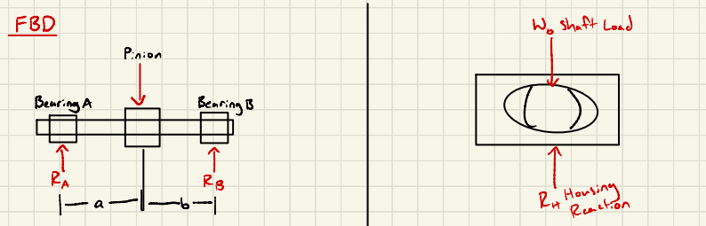

*Figure 7: Free-body diagrams showing the gear tooth forces and journal bearing reactions.*

## 4.3 Symbolic Bearing Analysis

The following bearing properties were evaluated:

- Projected contact area
- Average bearing pressure
- Shaft surface velocity
- Pressure-velocity (PV) rating
- Minimum required bearing length

The bearing sizing equations were used to compare calculated operating conditions with allowable material limits.

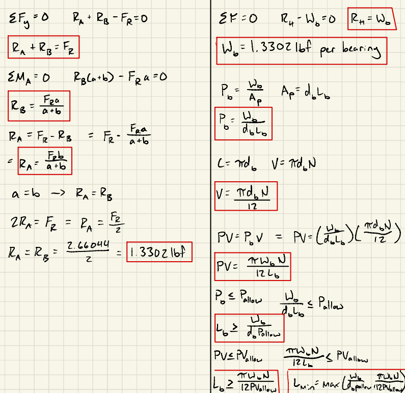

*Figure 8: Symbolic calculations for bearing pressure, velocity, and PV rating.*

## 4.4 Input Journal Bearing

Selected component: McMaster-Carr 6391K111

Material: SAE 841 oil-embedded bronze

Nominal application dimensions:

- Shaft diameter: 0.125 in
- Housing bore: 0.250 in
- Bearing length: 0.250 in

Actual dimensions displayed in the Fusion 360 drawing:

- Inside diameter: 0.126 in
- Outside diameter: 0.252 in
- Length: 0.250 in
- Calculated radial wall thickness: 0.0630 in

Calculated operating values:

- Radial load per bearing: 1.33022 lbf
- Average bearing pressure: 42.567 psi
- Surface velocity: 95.993 ft/min
- Operating PV: 4086.15 psi-ft/min

The calculated values were below the preliminary allowable pressure, velocity, and PV limits for the selected bearing material.

## 4.5 Output Journal Bearing

Selected component: McMaster-Carr 6391K131

Material: SAE 841 oil-embedded bronze

Nominal application dimensions:

- Shaft diameter: 0.250 in
- Housing bore: 0.375 in
- Bearing length: 0.250 in

Actual dimensions displayed in the Fusion 360 drawing:

- Inside diameter: 0.251 in
- Outside diameter: 0.376 in
- Length: 0.250 in
- Calculated radial wall thickness: 0.0625 in

Calculated operating values:

- Radial load per bearing: 1.33022 lbf
- Average bearing pressure: 21.284 psi
- Surface velocity: 71.995 ft/min
- Operating PV: 1532.31 psi-ft/min

The output bearing also satisfied the preliminary pressure, velocity, and PV requirements.

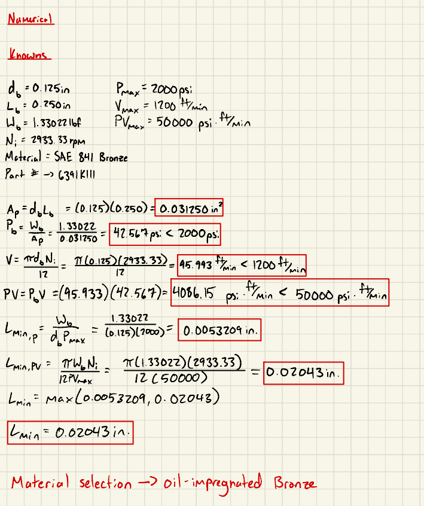

*Figure 9: Numerical calculations for the input and output journal bearings.*

## 4.6 Decide — Bearing Selection

SAE 841 oil-embedded bronze was selected because it provides embedded lubrication and meets the preliminary bearing pressure, velocity, and PV requirements.

The selected components were:

- Input bearing: 6391K111
- Output bearing: 6391K131

Two of each bearing were used.

**Decision: Use four standard bronze sleeve bearings in the gearbox assembly.**

The bearing selections satisfy the preliminary operating calculations. Final verification of running clearance, interference fits, and alignment is still required.

---

# 5. Analyze — Journal Bearing Wall Thickness

## 5.1 Bearing Geometry

The journal bearings are cylindrical sleeves with hollow central bores.

The input bearing nominal design dimensions were:

- Inner radius: 0.0625 in
- Outer radius: 0.1250 in
- Nominal wall thickness: 0.0625 in

The actual imported CAD model showed slightly different diameters.

Both selected bearing types have approximately the same wall thickness.

## 5.2 Bearing Stress Free-Body Diagram

The journal bearing experiences radial loading from the rotating shaft and a supporting reaction from the gearbox housing.

The bearing wall analysis considered:

- Radial stress
- Circumferential or hoop stress
- Housing interference pressure
- Equivalent von Mises stress

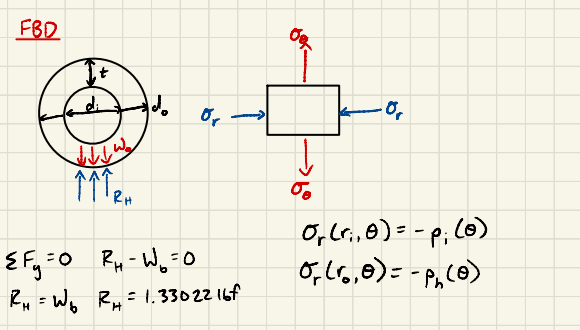

*Figure 10: Free-body diagram showing the stresses acting around the journal bearing wall.*

## 5.3 Symbolic Stress Analysis

Lamé's thick-walled cylinder equations were used to establish the relationship between idealized uniform pressure and stresses in the bearing wall.

The analysis evaluated the effect of external pressure generated by the housing interference fit.

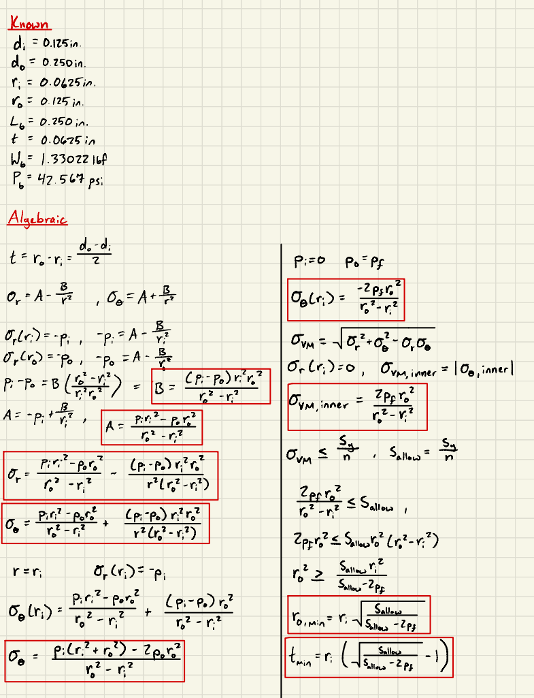

*Figure 11: Symbolic radial and hoop stress calculations for the journal bearing.*

## 5.4 Numerical Results

Using the preliminary nominal bearing dimensions:

- Nominal wall thickness: 0.062500 in
- Assumed yield strength: 11,000 psi
- Required factor of safety: 2.0
- Allowable equivalent stress: 5500 psi
- Maximum allowable external pressure under the simplified model: 2062.5 psi

An illustrative external contact pressure of 500 psi produced:

- Equivalent stress: 1333.33 psi
- Actual factor of safety: 8.250
- Theoretical minimum wall thickness: 0.0065963 in

The 500 psi contact pressure was an assumed value used to demonstrate the stress relationship. It was not a verified installation pressure.

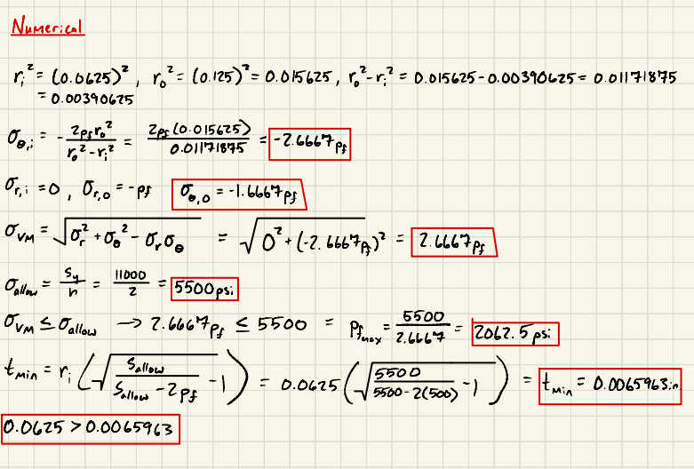

*Figure 12: Numerical calculations used to evaluate the journal bearing wall thickness.*

## 5.5 Decide — Wall Thickness

The selected journal bearings have nominal wall thicknesses of approximately 0.0625 inches.

**Decision: Retain the commercial bearing wall thicknesses.**

The bearing thicknesses are reasonable for the preliminary design. However, actual installation pressure must be determined from the housing and bearing fit specifications before physical manufacturing.

---

# 6. Decide — Gearbox Housing Design

## 6.1 Housing Configuration

A rectangular two-component housing was selected for the gearbox.

The housing consists of:

- Lower housing
- Upper housing
- Internal gear cavity
- Input and output bearing holes
- Four mounting holes

The two-piece design allows the gearbox to be assembled and disassembled for maintenance.

## 6.2 Material Selection

Aluminum 6061-T6 was selected for the housing.

The material was chosen because it provides:

- Good machinability
- Relatively low weight
- Adequate strength for the preliminary design
- Good availability
- Compatibility with conventional manufacturing methods

## 6.3 Housing Dimensions

Overall assembled housing:

- Length: 2.500 in
- Width: 2.000 in
- Thickness: 0.800 in

Each housing half:

- Length: 2.500 in
- Width: 2.000 in
- Thickness: 0.400 in
- Cavity length: 2.000 in
- Cavity width: 1.500 in
- Cavity depth: 0.150 in

Total central cavity height: 0.300 in

## 6.4 Shaft Center Locations

Output shaft center:

- X = 0.9500 in
- Y = 1.0000 in

Input shaft center:

- X = 1.6375 in
- Y = 1.0000 in

Calculated center distance: 0.68750 in

Nominal bearing hole diameters:

- Input bearing hole: 0.250 in
- Output bearing hole: 0.375 in

The actual manufactured housing bore sizes require fit-specific tolerances.

## 6.5 Mounting Hole Locations

Four clearance holes were added to each housing half.

Nominal hole diameter: 0.128 in

Locations:

- Bottom-left: (0.125, 0.125)
- Bottom-right: (2.375, 0.125)
- Top-left: (0.125, 1.875)
- Top-right: (2.375, 1.875)

## 6.6 Fastening Method

Four #4-40 machine screws and matching hex nuts were selected to connect the two housing components.

The fasteners used in the final assembly drawing were:

- McMaster-Carr 92949A116 button-head screws
- McMaster-Carr 90760A005 narrow-profile hex nuts

The removable fasteners allow the gearbox housing to be opened for inspection and maintenance.

**Decision: Use a removable two-piece housing with four screws and nuts.**

---

# 7. Communicate — Fusion 360 CAD Modeling

## 7.1 Modeling Approach

Fusion 360 was used to create the individual gearbox components and complete assembly.

The housing and shaft components were created in separate part files and inserted into a main assembly file.

This approach made it easier to organize the components, establish assembly relationships, and produce individual engineering drawings.

## 7.2 Parametric Modeling

Named user parameters were used to control the gearbox dimensions.

The parameters included as shown below in Fusion 360:

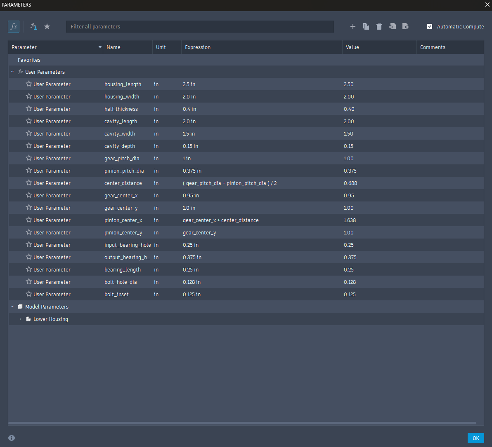

Parametric modeling allowed related dimensions to be modified while maintaining the intended geometric relationships.

## 7.3 Lower Housing Modeling

The lower housing was created using the following process:

1. Sketch a 2.500 × 2.000-inch rectangle.
2. Extrude the rectangle to create the housing blank.
3. Sketch the centered internal cavity.
4. Cut the cavity to the required depth.
5. Create the input bearing hole.
6. Create the output bearing hole.
7. Establish the 0.68750-inch shaft center distance.
8. Create the four mounting holes.

The completed housing contained the required features for supporting the gearbox components.

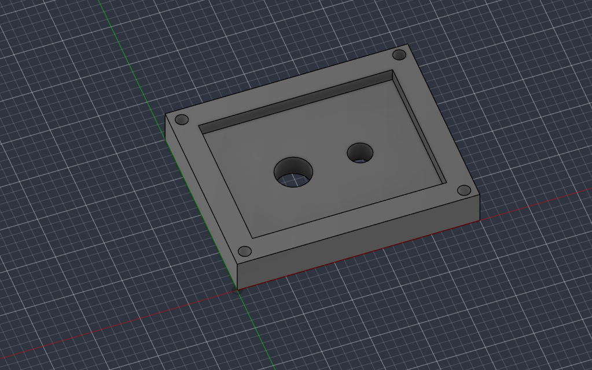
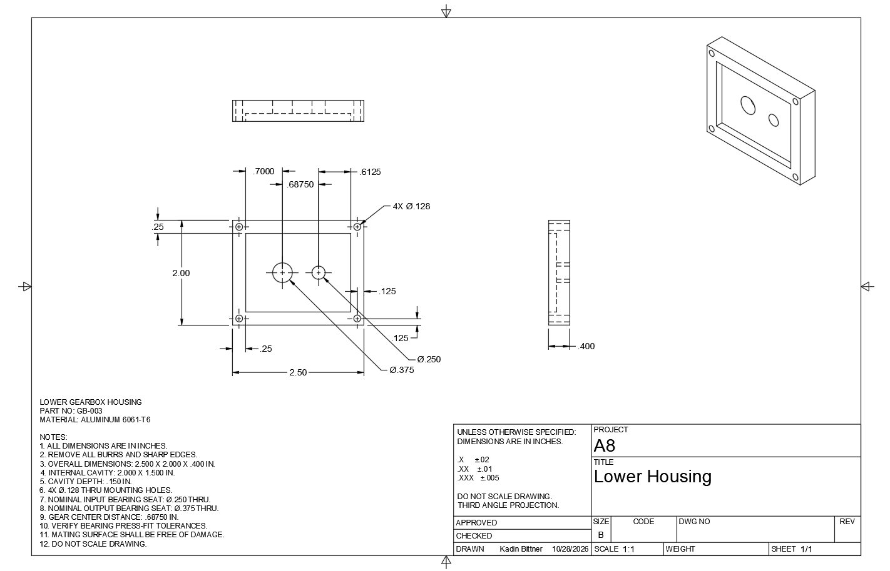

*Figure 13: Completed lower housing engineering drawing and model showing the cavity, bearing holes, mounting holes, dimensions, and material information.*

## 7.4 Upper Housing Modeling

The upper housing was created using a copy of the lower housing geometry in a separate Fusion 360 part file.

The geometry was kept identical so that the bearing holes and mounting holes would align.

During assembly, the upper housing was rotated so that both internal cavities faced one another.

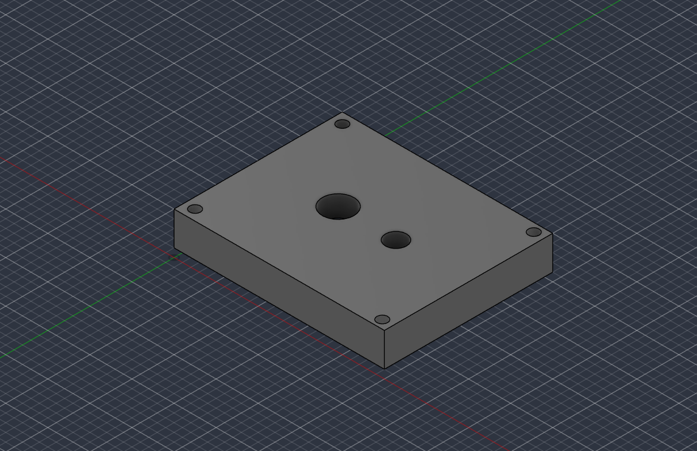
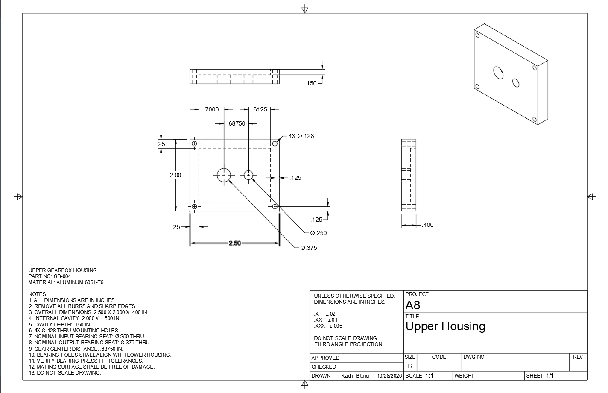

*Figure 14: Completed upper housing engineering drawing and model with the corresponding bearing and mounting hole locations.*

## 7.5 Shaft Modeling

The input and output shafts were created as separate components.

Input shaft:

- Diameter: 0.125 in
- Length: 1.000 in

Output shaft:

- Diameter: 0.250 in
- Length: 1.000 in

Both shafts were modeled as solid cylinders using the assignment dimensions.

## 7.6 Journal Bearing Components

The journal bearings were obtained from McMaster-Carr CAD models.

Selected components:

- Input bearing: 6391K111
- Output bearing: 6391K131

Two bearings were installed for each shaft.

Rigid Joints were used to position the bearings within the housing.

## 7.7 Gear Components

The input pinion and output gear were imported from McMaster-Carr.

Components:

- Input Pinion: 7880K19
- Output Gear: 7880K24

Each gear was placed coaxially with its corresponding shaft.

Rigid Joints were used to represent the intended press-fit connection between each gear and shaft.

The gears were positioned to maintain the calculated center distance and proper axial alignment.

## 7.8 Assembly Relationships

The gearbox assembly used several Fusion 360 joint types.

Rigid Joints were used for:

- Fixed housing relationships
- Journal bearings and housing
- Gears and shafts
- Screws and nuts

Revolute Joints were used for:

- Input shaft
- Output shaft

The Revolute Joints allow the shafts to rotate without axial translation.

## 7.9 Gear Motion Link

A Motion Link was created between the two shaft Revolute Joints.

The motion relationship was based on the 18-tooth input pinion and 48-tooth output gear.

For one full input shaft revolution:

- Input rotation: 360 degrees
- Output rotation: 135 degrees
- Output direction: Opposite the input

This represents the calculated reduction ratio of 2.66667:1.

## 7.10 Complete Gearbox Assembly

The final gearbox assembly contains:

- 1 lower housing
- 1 upper housing
- 1 input shaft
- 1 output shaft
- 2 input journal bearings
- 2 output journal bearings
- 1 input pinion
- 1 output gear
- 4 machine screws
- 4 hex nuts

**Total physical components: 18**

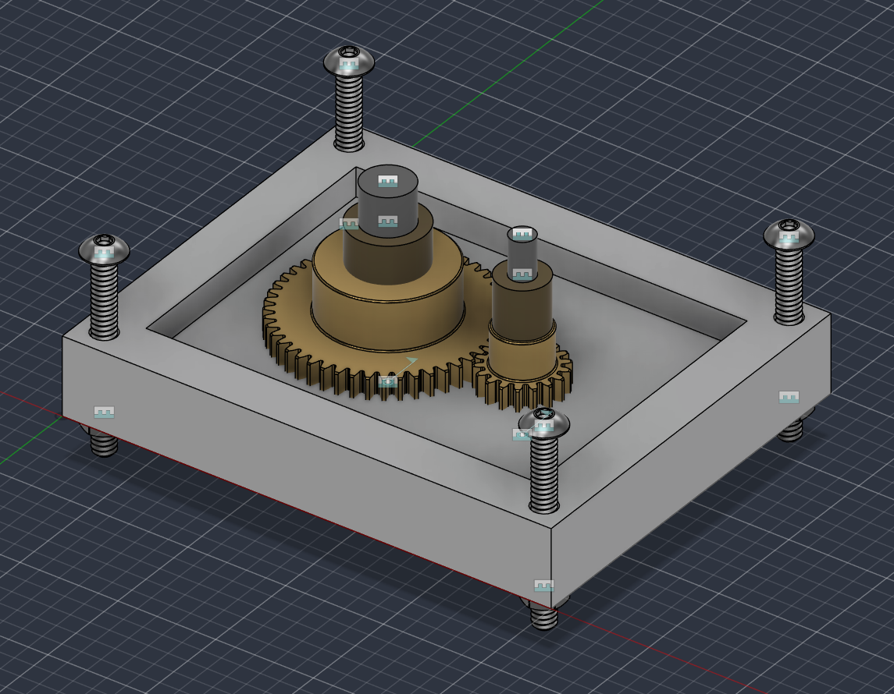
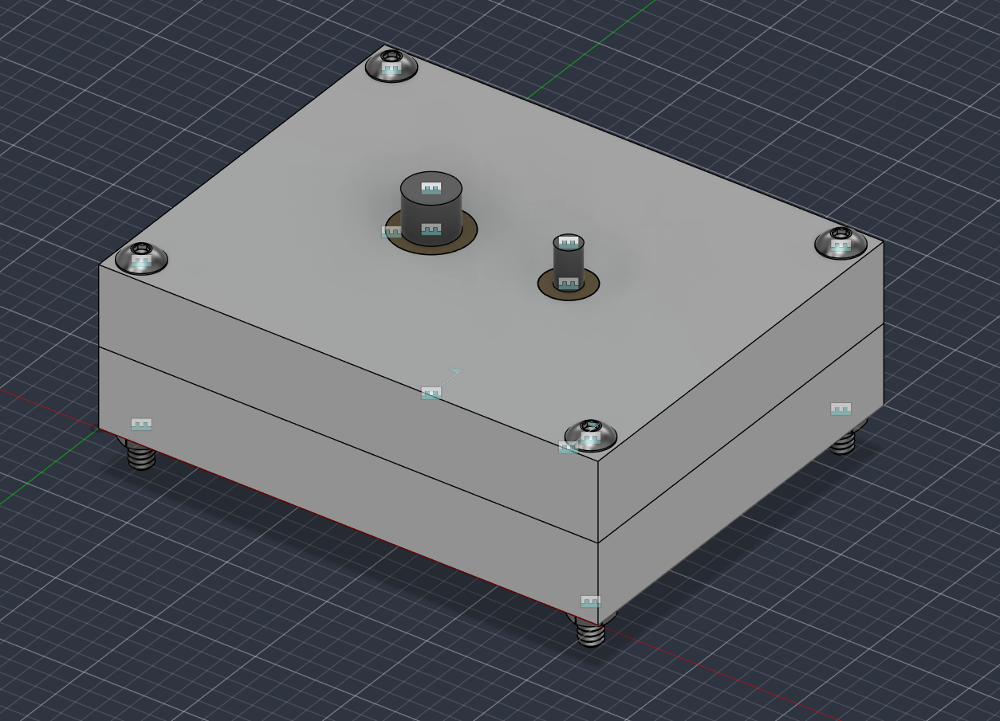
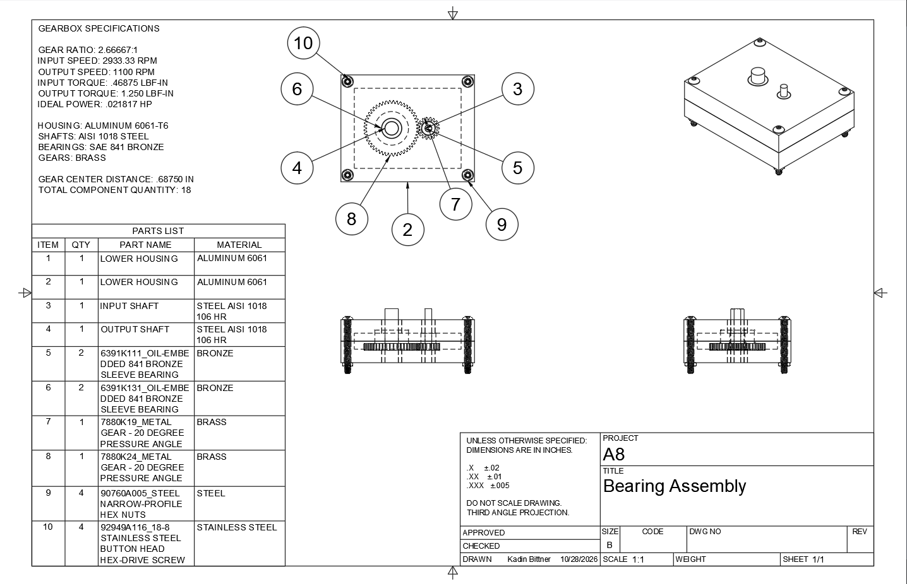

*Figure 15: Complete gearbox assembly drawing showing component locations, item balloons, parts list, and operating specifications.*

---

# 8. Communicate — Engineering Drawings

## 8.1 Drawing Requirements

Seven engineering drawings were created to document the gearbox design.

These included:

- Two shaft drawings
- Two housing drawings
- Two journal bearing drawings
- One complete assembly drawing

The purchased brass gears were included in the CAD assembly and bill of materials but did not require individual engineering drawings.

The drawings were created using third-angle projection and ASME dimensioning conventions.

The assignment specified the following general tolerances:

- X.X = ±0.02 in
- X.XX = ±0.01 in
- X.XXX = ±0.005 in

Critical dimensions such as bearing seats and gear center distance require additional tolerance verification.

## 8.2 Drawing 1 — Input Shaft

Drawing Number: GB-001

Material: AISI 1018 Cold-Drawn Steel

Dimensions:

- Diameter: 0.125 in
- Length: 1.000 ±0.005 in

The drawing includes an end view, side view, isometric view, and notes identifying the shaft material and intended fits.

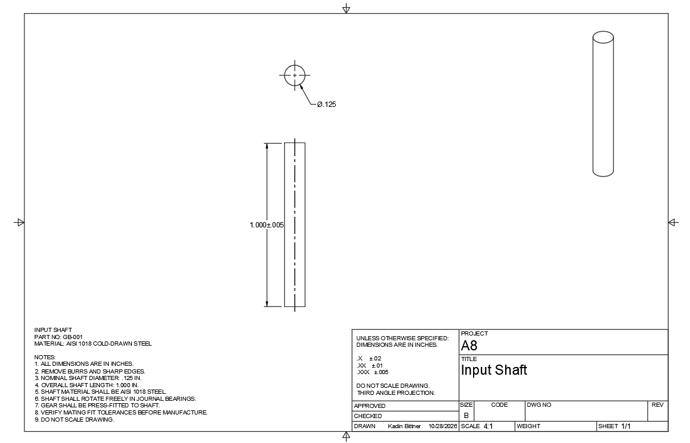

*Figure 16: Completed input shaft drawing showing the diameter, length, material, and general tolerances.*

## 8.3 Drawing 2 — Output Shaft

Drawing Number: GB-002

Material: AISI 1018 Cold-Drawn Steel

Dimensions:

- Diameter: 0.250 in
- Length: 1.000 ±0.005 in

The drawing includes an end view, side view, isometric view, and notes identifying the shaft material and intended fits.

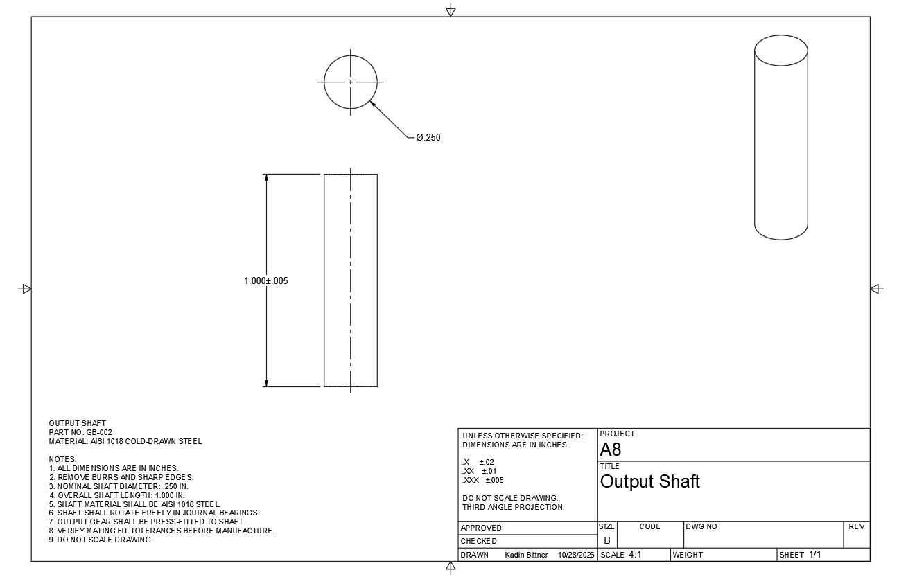

*Figure 17: Completed output shaft drawing showing the diameter, length, material, and general tolerances.*

## 8.4 Drawing 3 — Lower Housing

Drawing Number: GB-003

Material: Aluminum 6061-T6

Dimensions:

- Length: 2.500 in
- Width: 2.000 in
- Thickness: 0.400 in
- Cavity depth: 0.150 in

Nominal bearing holes:

- Input: Ø0.250 in
- Output: Ø0.375 in

The drawing also includes the mounting hole pattern and the 0.68750-inch shaft center distance.

*Figure 18: Lower housing drawing showing orthographic views, hole locations, dimensions, notes, and title block.*

## 8.5 Drawing 4 — Upper Housing

Drawing Number: GB-004

Material: Aluminum 6061-T6

Dimensions:

- Length: 2.500 in
- Width: 2.000 in
- Thickness: 0.400 in
- Cavity depth: 0.150 in

The upper housing contains the same nominal hole locations and cavity geometry as the lower housing.

*Figure 19: Upper housing drawing showing the cavity, bearing seat locations, mounting hole pattern, and material notes.*

## 8.6 Drawing 5 — Input Journal Bearing

Drawing Number: GB-005

McMaster-Carr Part Number: 6391K111

Material: SAE 841 Oil-Embedded Bronze

Dimensions displayed in the drawing:

- Inside diameter: 0.126 in
- Outside diameter: 0.252 in
- Length: 0.250 in

The component is intended for a nominal 0.125-inch shaft and nominal 0.250-inch housing bore.

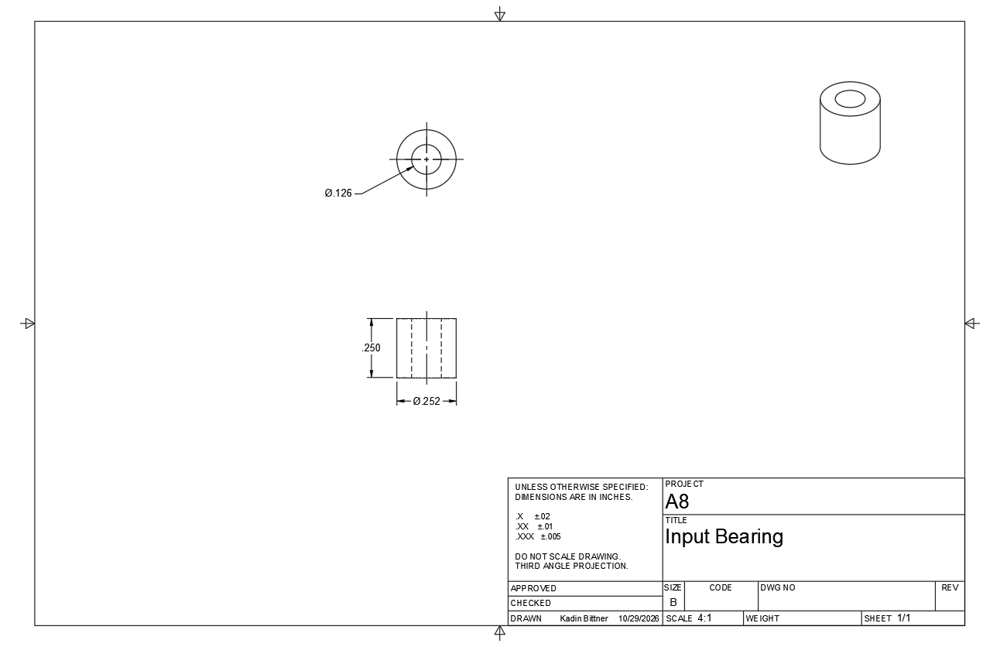

*Figure 20: Input journal bearing drawing showing the actual imported CAD model dimensions.*

## 8.7 Drawing 6 — Output Journal Bearing

Drawing Number: GB-006

McMaster-Carr Part Number: 6391K131

Material: SAE 841 Oil-Embedded Bronze

Dimensions displayed in the drawing:

- Inside diameter: 0.251 in
- Outside diameter: 0.376 in
- Length: 0.250 in

The component is intended for a nominal 0.250-inch shaft and nominal 0.375-inch housing bore.

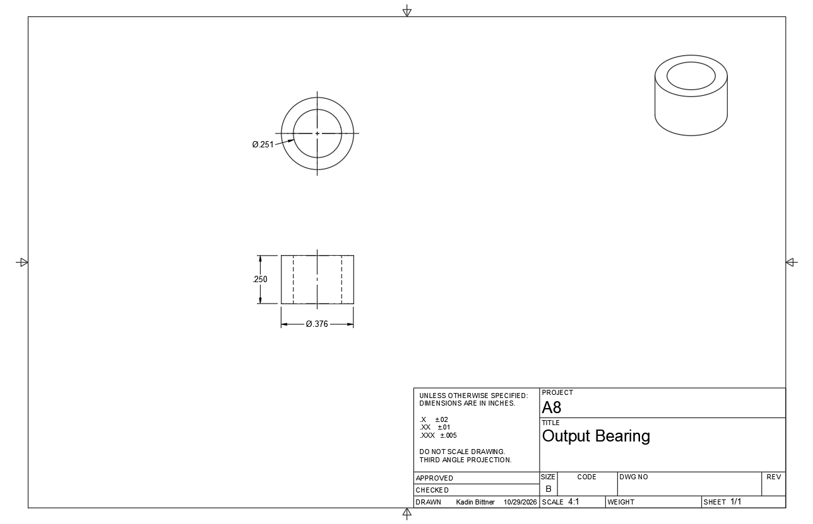

*Figure 21: Output journal bearing drawing showing the actual imported CAD model dimensions.*

## 8.8 Drawing 7 — Complete Gearbox Assembly

Drawing Number: GB-007

The complete assembly drawing includes:

- Top view
- Front view
- Right-side view
- Isometric view
- Component balloons
- Bill of materials
- Gearbox operating specifications
- General tolerance block
- Assembly title block

The drawing identifies 18 physical components across 10 distinct part types.

*Figure 22: Complete gearbox assembly drawing showing the assembled housing, shafts, bearings, gears, screws, nuts, and bill of materials.*

# 9. Decide — Important Design Decisions

## Decision 1: Shaft Diameters

The original input and output shaft diameters were retained because both exceeded the minimum diameter requirements under pure torsion.

The specified shaft diameters also maintained nominal compatibility with the selected gears and journal bearings.

## Decision 2: Bearing Material

SAE 841 oil-embedded bronze was selected because it provides embedded lubrication and satisfied the preliminary operating pressure, velocity, and PV calculations.

## Decision 3: Bearing Arrangement

Two bearings per shaft were selected to provide support on both sides of the gears.

This arrangement simplified the bearing reaction calculations and provided a straightforward method for positioning the shaft assemblies.

## Decision 4: Housing Configuration

A two-piece aluminum housing was selected instead of a permanently enclosed housing.

This allows the internal components to be accessed for inspection and maintenance.

## Decision 5: Fastening Method

Four #4-40 machine screws and nuts were used to connect the housing components.

This removable fastening method supports the assembly and disassembly requirement.

## Decision 6: Separate Component Files

The housing and shaft components were created in separate Fusion 360 files.

These were then inserted into a complete assembly.

This approach improved the organization of the project and simplified the creation of individual engineering drawings.

---

# 10. Lessons Learned

## 10.1 Shaft Strength

The shaft calculations demonstrated the importance of diameter in resisting torsional loading.

Although the output shaft transmits more torque, its larger diameter results in a lower nominal torsional shear stress.

This reinforced the relationship between shaft geometry and mechanical stress.

## 10.2 Journal Bearing Design

The journal bearing analysis demonstrated that bearing selection requires more than simply matching a shaft diameter.

Pressure, surface velocity, PV rating, wall thickness, lubrication, and installation tolerances must all be considered.

## 10.3 Commercial Bearing Dimensions

One important observation was that the actual imported bearing dimensions were different from the nominal shaft and housing dimensions.

For example, the input bearing drawing showed a 0.126-inch inside diameter and 0.252-inch outside diameter.

This demonstrated the importance of checking manufacturer dimensions and understanding the differences between running fits and interference fits.

## 10.4 Parametric Modeling

Using named parameters in Fusion 360 made the housing easier to model and modify.

The shaft center distance was particularly important because it determines the location of the meshing gears.

## 10.5 Separate CAD Components

Creating separate component files improved the organization of the project.

It also made individual engineering drawings easier to create.

## 10.6 Conflicting Assembly Relationships

One problem encountered during assembly was a warning indicating that Fusion 360 could not resolve the component positions.

The issue involved conflicting constraints between the upper and lower housing components.

Removing the conflicting relationships resolved the warning.

This demonstrated the importance of avoiding unnecessary or redundant assembly constraints.

## 10.7 Understanding Joint Types

The gearbox assembly required both Rigid and Revolute Joints.

Rigid Joints were used for components intended to remain fixed relative to one another.

Revolute Joints were used for the rotating shafts.

The Motion Link connected the shaft rotations according to the calculated gear ratio.

## 10.8 Engineering Drawings

Creating the engineering drawings reinforced the importance of proper dimensions, view placement, tolerancing, and title blocks.

The bearing drawings demonstrated why manufacturer-controlled dimensions should be used for commercially purchased components.

The assembly drawing also demonstrated the importance of correctly organizing component names, item balloons, and bill of materials quantities.

## 10.9 Assembly and Disassembly

The project demonstrated how component placement and fastening methods influence the assembly process.

The housing must support the bearings and maintain gear alignment while still allowing access to the internal components.

---

# 11. Remaining Design Verification

Before physical manufacturing, the following items should be verified:

- Shaft-to-bearing running clearances
- Gear-to-shaft press-fit tolerances
- Bearing-to-housing installation fits
- Bearing alignment
- Gear hub axial clearance
- Tangential-force bending stresses in shafts
- Screw and nut edge clearances
- Shaft axial retention
- External shaft connection lengths
- Critical dimension tolerances
- Physical assembly and disassembly sequence

These items distinguish the preliminary CAD design from a fully verified manufacturing design.

---

# 12. Project Time

The assignment required documentation of the time spent completing the project.

- Initial calculations: 4 hours
- Fusion 360 part modeling: 1.5 hours
- Fusion 360 assembly: 1 hour
- Engineering drawings: 3.5 hours
- Portfolio documentation: 3 hours

**Total Project Time: 13 hours**

---

# 13. Conclusion

The objective of this assignment was to develop a gearbox using mechanical engineering calculations, commercially available components, and parametric CAD modeling.

The selected gearbox uses an 18-tooth input pinion and a 48-tooth output gear to achieve a 2.66667:1 speed reduction.

The preliminary shaft stress calculations indicated that both specified shaft diameters were sufficient under pure torsion.

The selected SAE 841 bronze journal bearings satisfied the preliminary pressure, velocity, and PV requirements.

A two-piece aluminum housing was developed to support the gears, shafts, and bearings while allowing assembly and disassembly.

Fusion 360 was used to create the individual components, establish assembly relationships, and prepare six component drawings and one complete assembly drawing.

The project demonstrated the importance of engineering analysis, component selection, parametric modeling, proper tolerancing, and documenting design decisions.

---

# 14. CAD Files and Drawings

## Fusion 360 CAD Files

The Fusion 360 design files contain the individual components and complete gearbox assembly as well as the engineering drawings.

**[DOWNLOAD GEARBOX CAD FILES AND DRAWINGS](Bearing_Assembly_and_Drawings.zip)**

# 15. References

1. McMaster-Carr. Input Pinion, Part 7880K19.  
   https://www.mcmaster.com/7880K19

2. McMaster-Carr. Output Gear, Part 7880K24.  
   https://www.mcmaster.com/7880K24

3. McMaster-Carr. Input Journal Bearing, Part 6391K111.  
   https://www.mcmaster.com/6391K111

4. McMaster-Carr. Output Journal Bearing, Part 6391K131.  
   https://www.mcmaster.com/6391K131

5. McMaster-Carr. Journal Bearings.  
   https://www.mcmaster.com/products/journal-bearings/

6. Autodesk. Fusion 360 Documentation.  
   https://help.autodesk.com/

7. Machinery's Handbook. Shaft Design, Gears and Gearing, and Plain Bearing Materials sections. Course-specified edition.

8. Dunn, D. J. Mechanical Power Transmission Systems: Tutorial Gears.  
   https://www.freestudy.co.uk/
