# A9 – Pulley System Design

## Objective

The objective of this assignment was to design a pulley system capable of transferring rotational power between two parallel shafts. The design required the use of friction analysis, stress analysis, material selection, and dynamic analysis to ensure that the system could operate safely.

The pulley system consists of two equal-diameter pulleys connected by a polyurethane round belt. Each pulley is supported by a steel shaft, journal bearings, and an aluminum frame.

The design was required to maintain a minimum safety factor of 3 while satisfying the specified geometric and operating conditions.

## Design Requirements

- Pulley diameter: 3 inches
- Center distance: 4–6 inches
- Rotational speed: 1000–2000 rpm
- Initial static belt tension: 4–6 lbf
- Belt material: Polyurethane rubber
- Belt yield strength: 471 psi
- Minimum safety factor: 3

## Selected Design Parameters

- Pulley diameter: 3 inches
- Center distance: 5 inches
- Operating speed: 1500 rpm
- Static belt tension: 5 lbf
- Pulley material: Steel
- Belt diameter: 0.250 inches
- Shaft material: AISI 1060 hardened steel
- Shaft diameter: 0.250 inches
- Journal bearing material: Porous bronze
- Frame material: 6061-T6 aluminum

---

# Analyze

## Part 1 – Belt Design

The first portion of the assignment involved selecting a suitable polyurethane round belt and determining the forces acting on both pulleys.

The belt was analyzed using the capstan friction equation and normal stress equations to determine the tight-side tension, loose-side tension, minimum belt diameter, and required circumference.

### Part 1a – Knowns and Unknowns

The known design requirements and unknown belt parameters were identified before beginning the analysis.

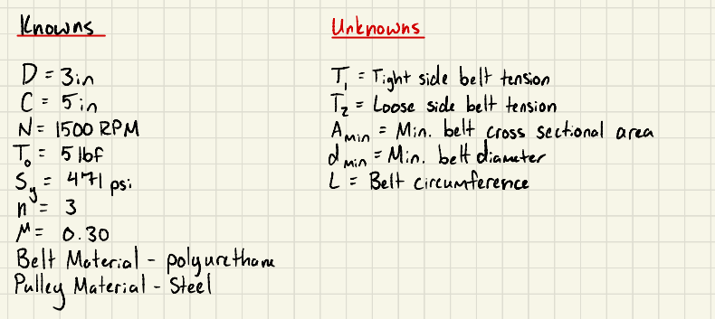

*Figure 1: Known and unknown parameters for the belt design.*

### Part 1b – Free-Body Diagram

Free-body diagrams were created to identify the belt tension forces, shaft reactions, and applied torques acting on the driving and driven pulleys.

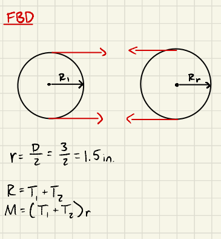

*Figure 2: Free-body diagrams of the belt and pulley system.*

### Part 1c – Symbolic Calculations

The capstan equation was used to derive expressions for the tight-side and loose-side tensions. Normal stress equations were then used to determine the minimum belt area and diameter.

The belt circumference was also expressed in terms of pulley diameter and center distance.

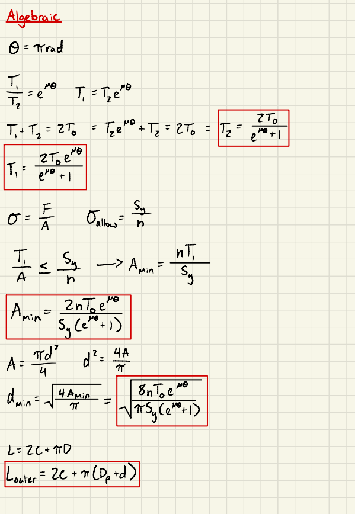

*Figure 3: Symbolic derivations for belt forces, diameter, and circumference.*

### Part 1d – Numerical Calculations

The selected operating conditions were substituted into the derived equations to determine the required belt dimensions.

A standard 0.250-inch polyurethane round belt was selected based on the calculated minimum diameter.

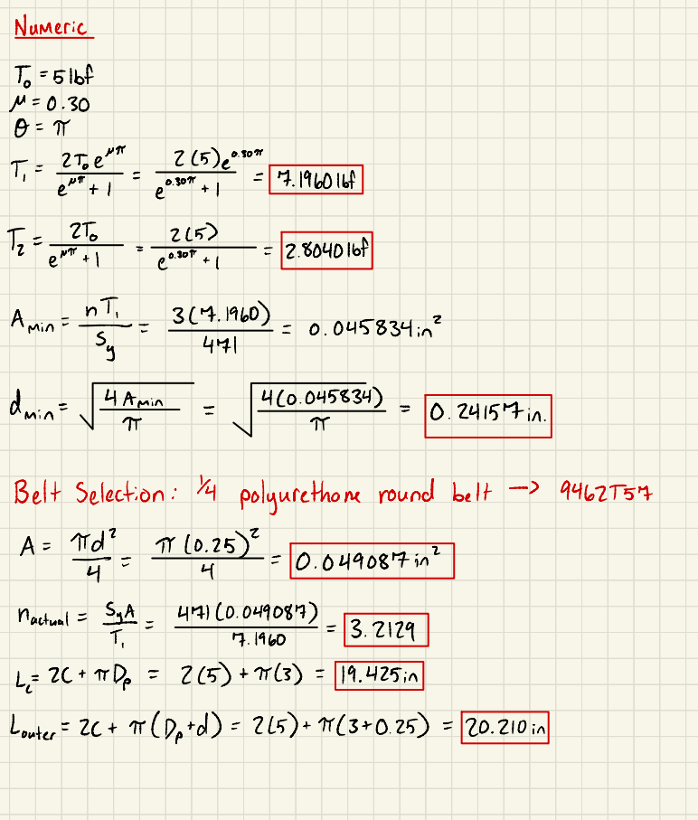

*Figure 4: Numerical calculations and preliminary belt safety-factor verification.*

---

## Part 2 – Shaft Design

The second portion of the assignment involved determining the minimum shaft diameter necessary to transmit torque safely.

AISI 1060 hardened steel was selected as the shaft material. The shaft was initially evaluated using torsional shear stress and the maximum shear stress failure criterion.

### Part 2a – Knowns and Unknowns

The known belt forces, pulley dimensions, material properties, and safety-factor requirement were identified.

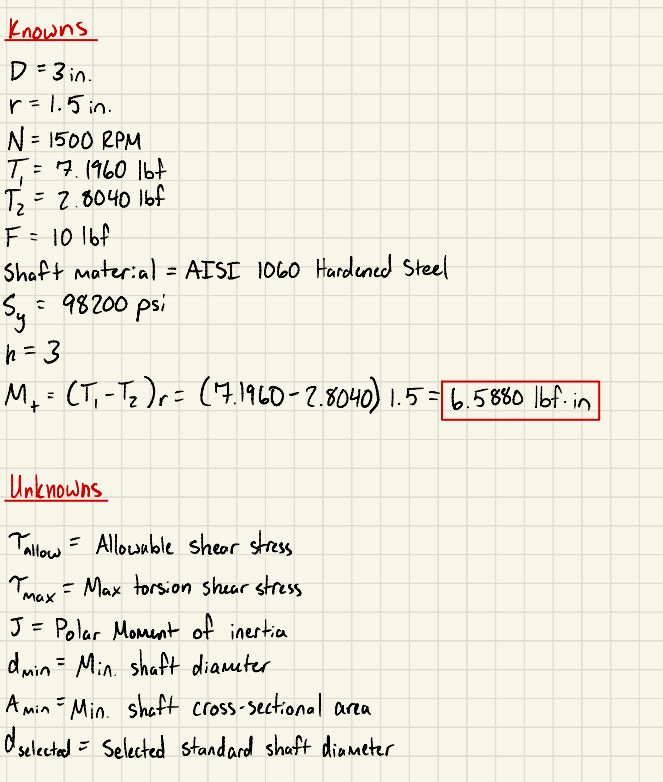

*Figure 5: Known and unknown parameters for the shaft design.*

### Part 2b – Shaft Free-Body Diagrams

Free-body diagrams were developed for the driving and driven shafts.

Each shaft was modeled with two supporting bearings and a pulley positioned between them. Bearing reactions and transmitted torque were identified.

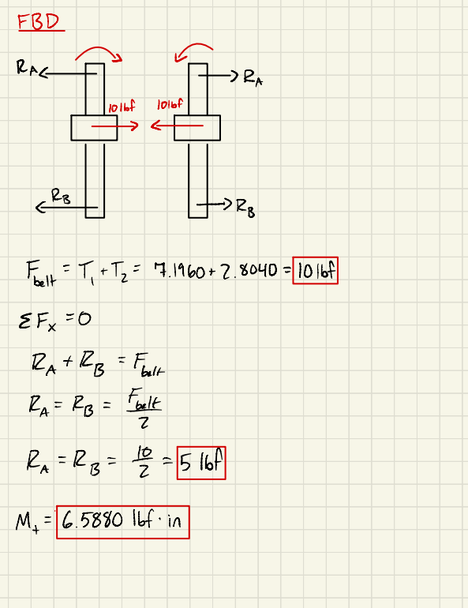

*Figure 6: Shaft free-body diagrams and bearing reaction calculations.*

### Part 2c – Symbolic Calculations

The torsional shear stress equation was used to derive the minimum shaft diameter.

The allowable shear stress was determined using the Tresca failure criterion and the required safety factor.

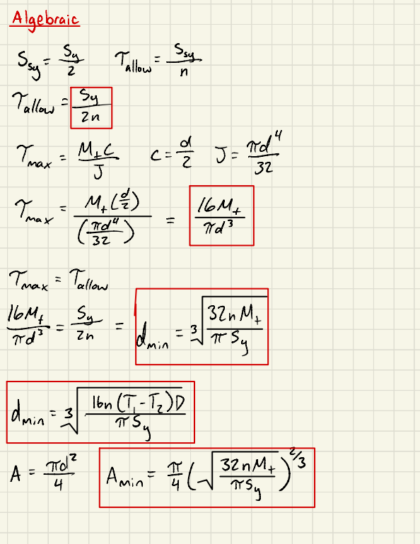

*Figure 7: Symbolic derivation of minimum shaft diameter and area.*

### Part 2d – Numerical Calculations

The transmitted torque and material properties were substituted into the derived equations.

A standard 0.250-inch shaft was selected because it exceeded the minimum diameter required by the pure-torsion analysis.

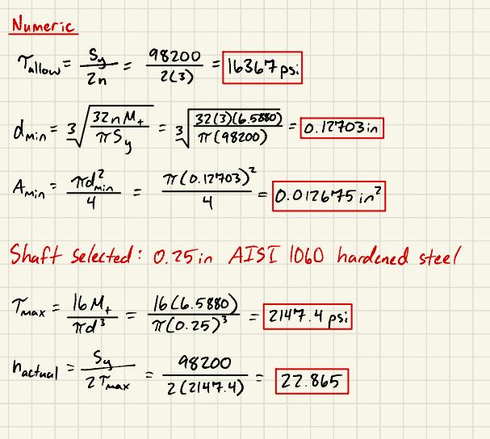

*Figure 8: Numerical shaft calculations and torsional safety-factor verification.*

---

## Part 3 – Journal Bearing Design

The third portion of the assignment involved selecting suitable journal bearings to support the rotating shafts.

The bearings were evaluated using radial loading, projected contact area, surface velocity, and pressure-velocity (PV) rating.

### Part 3a – Knowns and Unknowns

The shaft diameter, rotational speed, radial bearing loads, and preliminary bearing dimensions were identified.

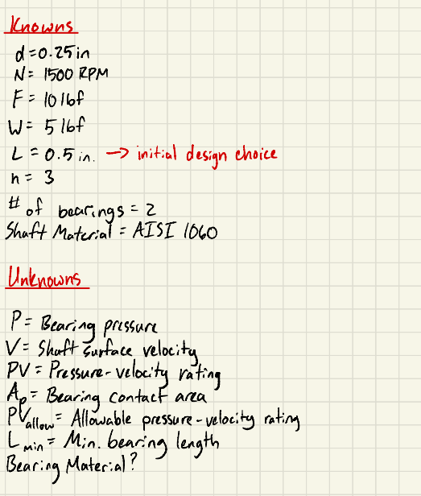

*Figure 9: Known and unknown parameters for journal bearing design.*

### Part 3b – Shaft and Bearing Free-Body Diagrams

Free-body diagrams were created to determine the radial forces carried by each bearing.

Two bearings were assigned to each shaft, with the pulley positioned centrally between the supports.

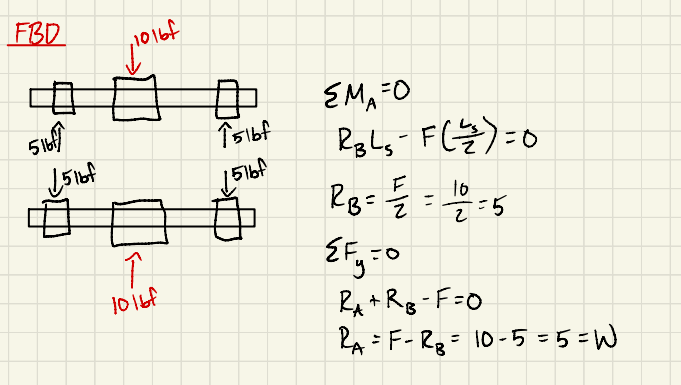

*Figure 10: Journal bearing free-body diagrams and reaction forces.*

### Part 3c – Symbolic Calculations

The equations for bearing pressure, linear velocity, and PV rating were derived.

The minimum bearing length was also expressed in terms of the applied load and allowable bearing material ratings.

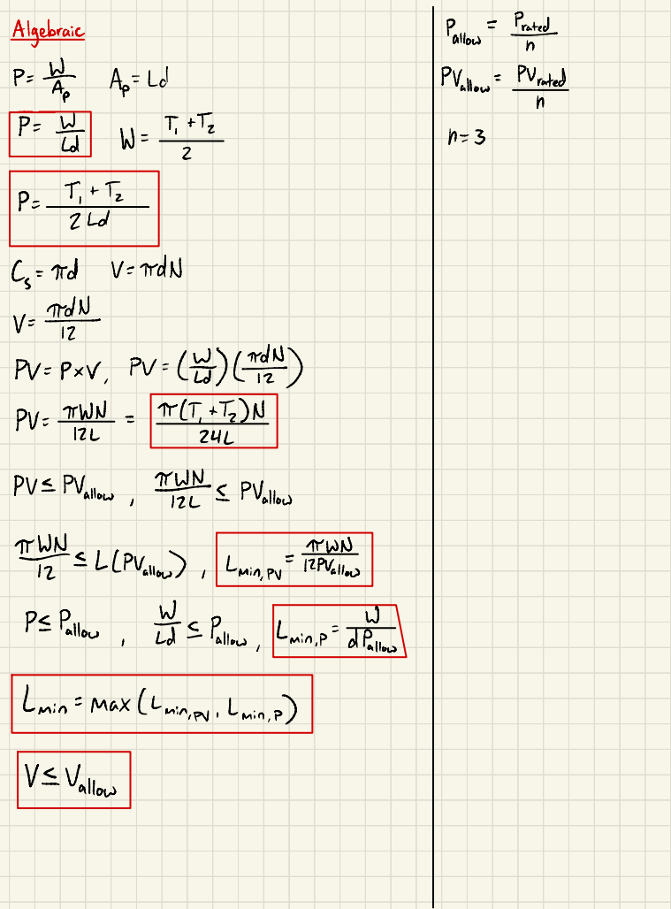

*Figure 11: Symbolic derivations for bearing pressure, velocity, and PV rating.*

### Part 3d – Numerical Calculations

The selected bearing dimensions and operating conditions were substituted into the derived equations.

The calculated pressure, velocity, and PV rating were used to determine the minimum material performance requirements.

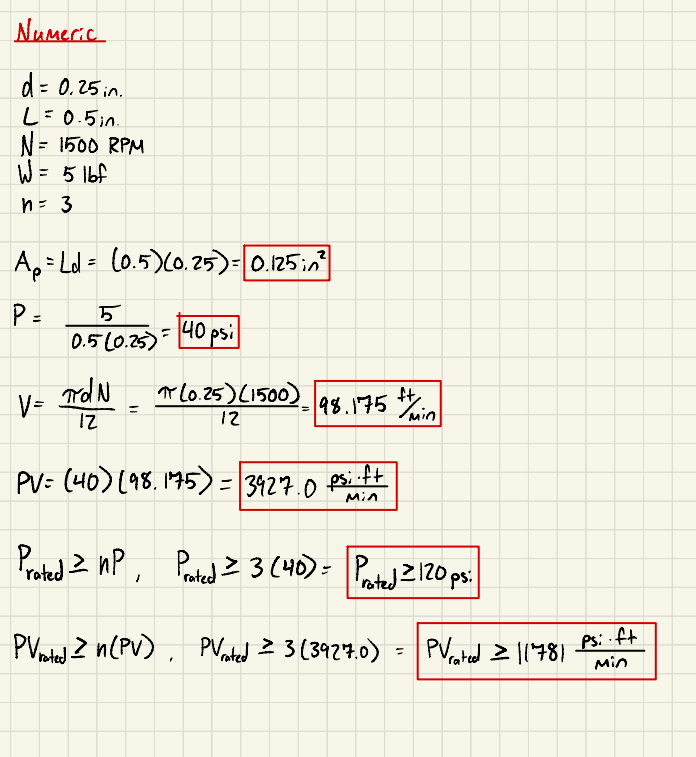

*Figure 12: Numerical journal bearing calculations.*

### Part 3e – Bearing Material Selection

Table 4 on page 2440 of Machinery's Handbook was used to compare the calculated operating conditions with available bearing materials.

Porous bronze was selected because of its self-lubricating properties and its ability to operate within the calculated pressure, velocity, and PV limits.

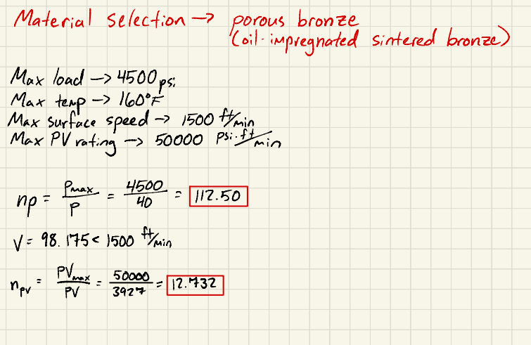

*Figure 13: Bearing material selection and operating-limit verification.*

---

## Part 4 – Frame Design

The fourth portion of the assignment involved designing a frame capable of supporting the shafts, bearings, and pulleys.

An analytical design approach was selected instead of CAD modeling because the frame could be evaluated using free-body diagrams and conventional strength-of-materials equations.

The proposed frame consists of two parallel aluminum support plates with bearing holes positioned 5 inches apart.

### Frame Geometry

The following preliminary dimensions were selected:

- Material: 6061-T6 aluminum
- Number of support plates: 2
- Overall plate length: 5.750 inches
- Plate width: 0.750 inches
- Plate thickness: 0.500 inches
- Bearing hole diameter: 0.375 inches
- Shaft center distance: 5.000 inches

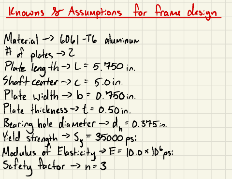

*Figure 14: Proposed frame geometry and dimensional layout.*

### Frame Free-Body Diagram

The forces transferred from the belt through the shafts and bearings were used to determine the loading on each support plate.

The frame was modeled under symmetrical loading, with each plate supporting the bearing reactions from both shafts.

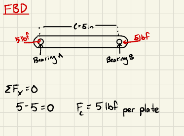

*Figure 15: Free-body diagram of the frame and applied bearing loads.*

### Frame Stress Analysis

The frame was evaluated using normal stress equations to determine the compressive stress caused by the bearing loads.

Additional checks were performed for the reduced cross-sectional area at the bearing holes, local bearing pressure, and shear tear-out.

*Figure 16: Analytical frame stress and safety-factor calculations.*

### Frame Analysis

The frame was checked to ensure proper operation when subjected to forces.

The frame was checked for shear and normal stresses to confirm the theoretical values would confirm acceptable geometry.

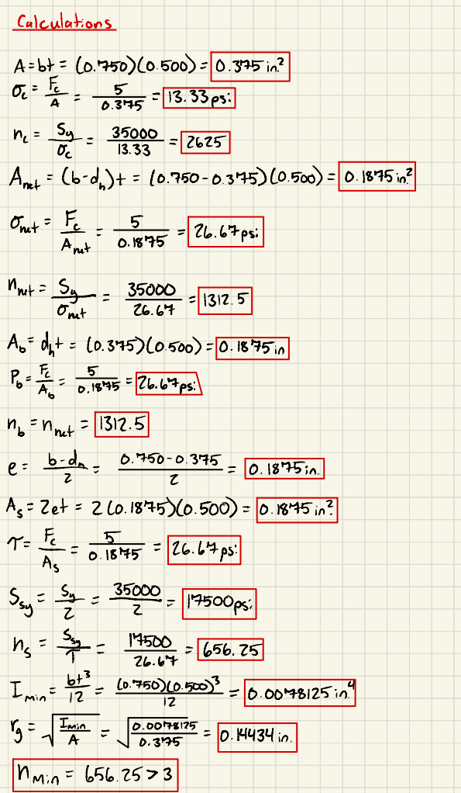

*Figure 17: Frame analysis and calculated safety factor.*

The preliminary analysis indicated that the selected aluminum support plates have a substantial strength margin under the assumed loading conditions.

---

# Decide

## Belt Selection

A 0.250-inch polyurethane round belt was selected because it exceeded the calculated minimum diameter while remaining compatible with the proposed pulley geometry.

The belt selection was based on the required tension, material yield strength, and minimum safety factor.

## Shaft Selection

A 0.250-inch AISI 1060 hardened steel shaft was selected for both pulleys.

This diameter was larger than the calculated minimum for pure torsion and provided additional strength margin.

## Journal Bearing Selection

Oil-impregnated porous bronze was selected for the journal bearings.

This material was chosen because its application limits exceeded the calculated bearing pressure, surface velocity, and PV requirements.

## Frame Selection

A two-plate frame made from 6061-T6 aluminum was selected.

Aluminum was chosen because of its strength, relatively low weight, and ease of manufacturing.

The frame was analyzed for compression, bearing pressure, and shear tear-out.

## Design Limitations

The design calculations were based on simplified operating conditions and assumed material properties.

Additional verification would be necessary before manufacturing, including belt pretension and stretch, groove geometry, combined shaft bending and torsion, bearing fits, and frame connections.

---

# Communicate

## Final Design Summary

The proposed pulley system consists of two 3-inch steel pulleys positioned 5 inches apart and connected using a polyurethane round belt.

Both pulleys operate at a nominal rotational speed of 1500 rpm, producing a 1:1 speed ratio under no-slip conditions.

The pulleys are supported by 0.250-inch steel shafts running through porous bronze journal bearings.

Two parallel 6061-T6 aluminum plates provide the main structural support.

The individual analytical calculations indicate that the preliminary component selections satisfy the specified safety-factor requirements under their respective simplifying assumptions.

## Part 5 – Engineering Lessons Learned

This assignment demonstrated how friction, belt tension, torque, material strength, and bearing loads must be considered together when designing a mechanical power transmission system.

One of the most important lessons was understanding the relationship between tight-side and loose-side belt tension and the torque that can be transmitted before slipping occurs.

The shaft analysis demonstrated how torsional shear stress affects the minimum required shaft diameter. It also showed why additional loading conditions, such as bending, should be considered before finalizing a shaft design.

The journal bearing analysis showed the importance of considering pressure and surface velocity together rather than selecting a bearing material based solely on its strength.

The frame analysis demonstrated how free-body diagrams and material mechanics equations can be used to evaluate a mechanical structure without requiring a CAD model.

Overall, the assignment reinforced the importance of combining multiple engineering concepts and checking how individual design decisions affect the complete system.

## Design Process and Revisions

The design process began with the selection of the pulley geometry and operating conditions.

The belt was analyzed first because its tension forces determined the loads applied to the remaining components.

Those forces were then used to size the shafts, determine bearing reactions, and select the journal bearing material.

Finally, the frame was analyzed using the loads transmitted through the bearings.

During the frame design, the initial approach involved considering a CAD model. The approach was revised to use analytical calculations and free-body diagrams to focus on the required structural analysis.

The calculations also identified assumptions that would need further verification before manufacturing the system.

## Time Required

Total time spent completing the assignment: 8 hours

## References

1. McMaster-Carr. "Round Belts."  
   https://www.mcmaster.com/products/round-belts/

2. Machinery's Handbook. "Application Limits — Sintered Metal and Nonmetallic Bearings." Table 4, page 2440.

3. Machinery's Handbook. "Simple Stresses." Page 217, Table 2.

4. Dunn, D. J. "Solid Mechanics – Dynamics: Tutorial – Pulley Drive Systems."

5. Wang, Cheng, Wua, Zhangb, and Suna. "Strain-induced Structural and Dynamic Changes in Segmented Polyurethane Elastomers." Used for the polyurethane material yield-strength assumption.
