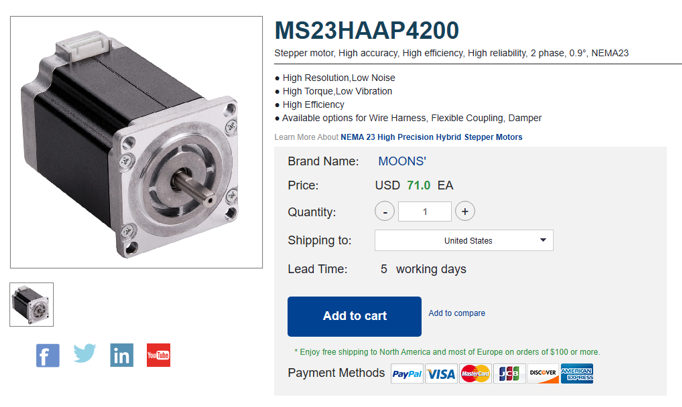
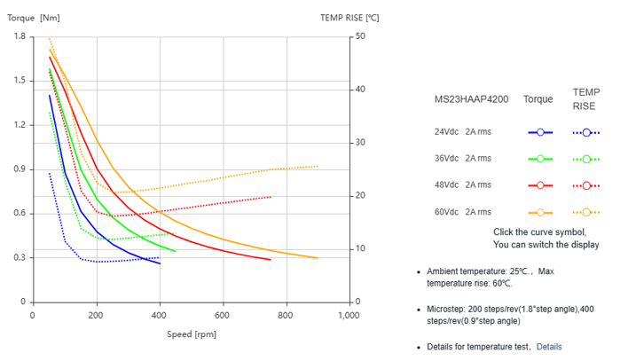
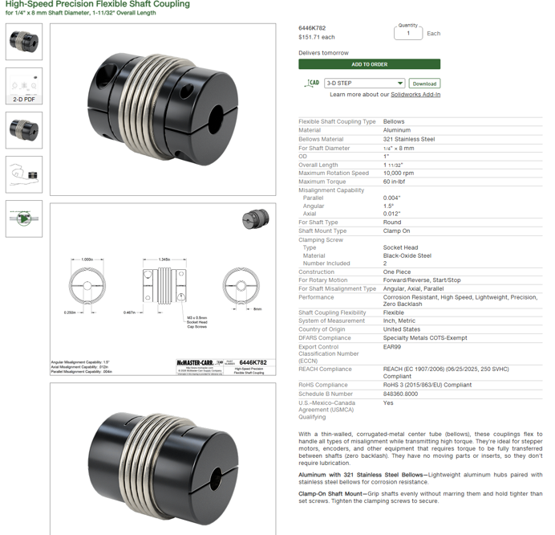
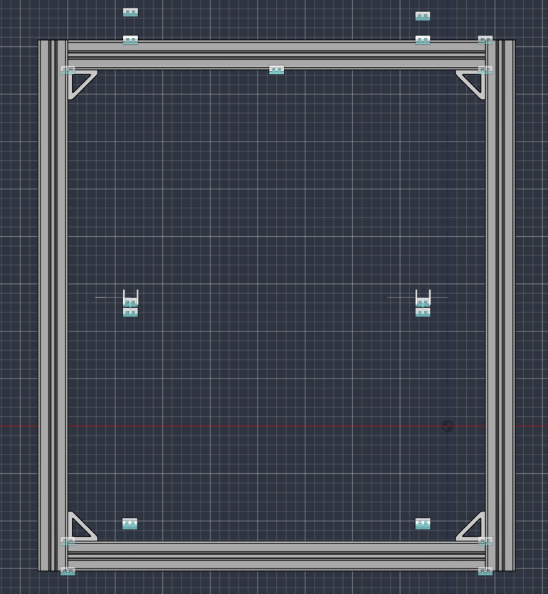
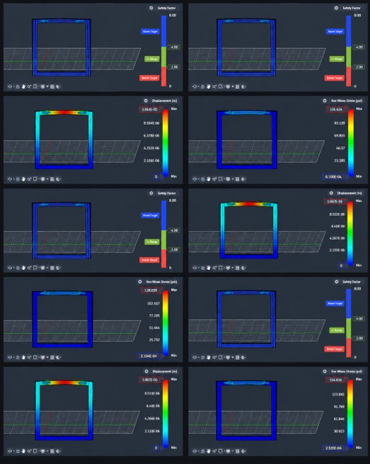
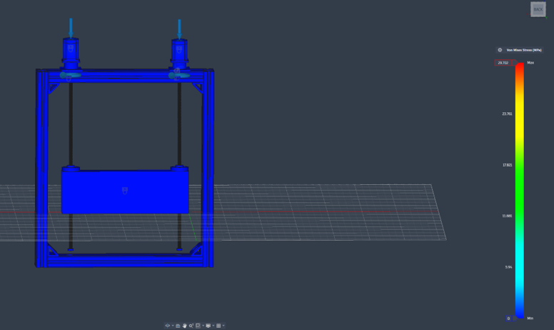
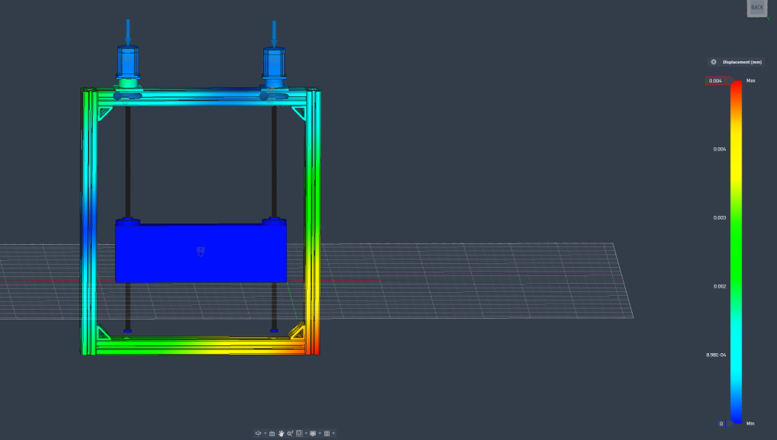
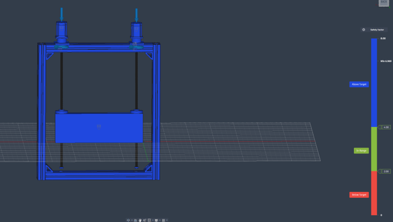
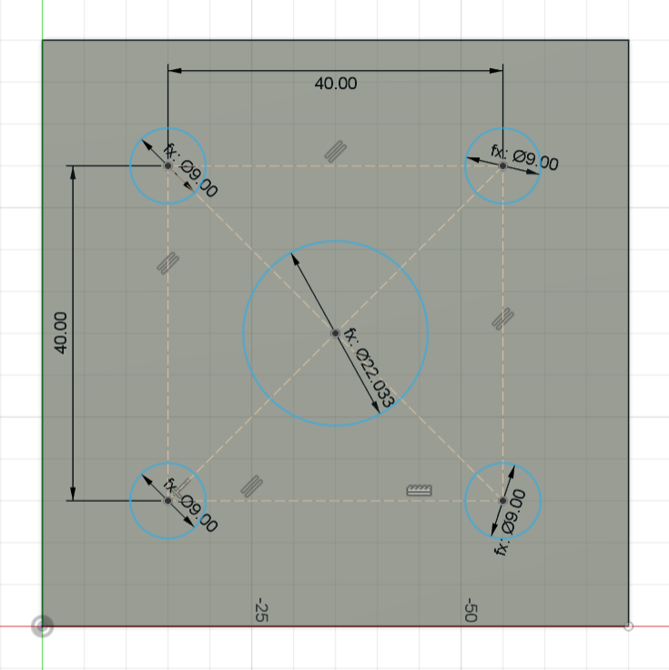

# A11 – Motor Selection

## Objective

.png)

.png)

.png)

.png)

.png)

.png)

.png)

.png)

## Motor Selection and Attachment:

### Motor Selection-

#### Motor

#### Speed Torque Curve

### Motor Mount-

#### Knowns/Unknowns

#### FBD

#### Equations

#### Numeric Solution

### Coupler-

#### Knowns/Unknowns

.png)

#### FBD

.png)

#### Equations

.png)

#### Numeric Solution/Coupler Selection

.png)

## Frame Design:

### Frame Connector Selections-

#### Knowns/Unknowns

.png)

#### FBD

.png)

#### Equations

.png)

#### Numeric Solution and Connector Selection

.png)

### Upper Beam FEA-

#### Model Setup

#### Meshing and Verification

#### Results

Maximum von Mises stress and location

Maximum vertical deflection at the grip line

Factor of Safety (based on chosen material yield)

Brief discussion of load path and any observed twisting/warping tendencies

#### Optimization Pass

### Vertical Frame Component FEA-

#### Model Setup

#### Meshing and Verification

#### Results

Maximum von Mises stress and location

Maximum vertical deflection at the grip line

Factor of Safety (based on chosen material yield)

Brief discussion of load path and any observed twisting/warping tendencies

#### Optimization Pass

## Floating Bearing Mount:

### Dimension and Loaction Justification-

Mounting Hole Location/Spacing-
The holes for mounting the bearing housing to the frame were spaced to allow for usage of the frames integrated T slots (40mm) that allow for mounting hardware to thread into T slot nuts. The housing was designed to be symmetrical for ease of installation so the distance along the length of the beam is also 40mm to allow for the housing to be mounted in either orientation. The mounting holes will be spaced 20mm off of the bearing hole, this is critical to ensure proper alignment.

Mounting Hole Diameter-
The mounting hole diameter is 9mm to allow for proper a proper clearance fit with the M8 fasteners.

Bearing Hole Diameter-
The bearing hole diameter is 22.033mm to allow for the proper RC3 fit with the lead screw bearing outer diameter of 22mm. This value lies close to the middle of the tolerance allowed for this fit class.

### Functional Tolerances-

Standard Tolerances-
The mounting hole locations and diameters will have the standard tolerances noted on their drawings. The diameter of the holes is much larger than required so no tighter tolerances are required, and the location of the holes, while important, can vary because the T slot nuts allow for some movement within the slot while still fastening correctly.

Increased Tolerance Precision-
The bearing mounting hole will have a higher degree of precision than the other features, this is due to the required clearance of the RC3 fit class which is 0.8 to 2.1 thou. This is ensured by setting an asymmetrical tolerance of + 0.007" and - 0.012". Staying within these tolerances will ensure the RC3 fit is achieved.

## Bill of Materials/ Labor Cost:

| Item Number | Quantity | Name | Cost($)/Item | Cost($) | Purchase Link |
| :---: | :---: | :---: | :---: | :---: | :---: |
| 1 | 2 | Lead Screw | 18.20 | 36.40 | [Lead Screw](https://www.roton.com/product/acme-steel-screw-right-59284/) |
| 2 | 2 | Nut | 23.57 | 47.14 | [Nut](https://www.roton.com/product/acme-bronze-threaded-mount-nut-right-90222/) |
| 3 | 2 | Flange | 49.63 | 99.26 | [Flange](https://www.roton.com/product/flange-steel-flange-89838/) |
| 4 | 4 | Guesset | 11.23 | 44.92 | [Gusset](http://8020.net/40-4334.html) |
| 5 | 2 | Bearing | 26.50 | 53.00 | [Bearing](https://www.traceparts.com/en/product/motion-industries-radialdeep-groove-ball-bearing-6082rsh?CatalogPath=TRACEPARTS:TP01002001001002&Product=90-06092022-035185) |
| 6 | 4 | Frame Member | 82.10/meter | 228.62 | [Frame Member](https://8020.net/40-4080.html) |
| 7 | 2 | Motor | 71.00 | 142.00 | [Motor](http://www.moonsindustries.com/p/nema-23-high-precision-hybrid-stepper-motors/ms23haap4200-000004611110015320) |
| 8 | 2 | Coupler | 151.71 | 303.42 | [Coupler](http://www.mcmaster.com/6446K782) |
|  |  |  | Total Cost: | 954.76 |  |

| Person | Hours Worked | Cost($)/Hour | Cost($) |
| :---: | :---: | :---: | :---: |
| Taylor Rockefeller | 10 | 35.00 | 350.00 |
| Kadin Bittner | 12 | 35.00 | 420.00 |
|  |  | Total Cost: | 770.00 |

Total Cost of Project: $1724.76

## Lessons Learned:

- Motor Selection- I learned how to analyze product data sheets and speed torque curves to properly select a motor to stay within project constraints.

- Motor Mount- I learned how to design a motor mount that fixed a selected motor to a frame member with proper fastening and alignment while ensuring proper material selection and dimensioning to avoid excessive deflection.

- Coupler- I learned how to conduct shear stress torsion analysis on a coupler feature to determine minimum outer diameter allowable given the inner diameter of the coupler being our lead screw and motor output feature dimensions. Conducting these calculations allowed for selection of a coupler that had a safety factor above the requirement.

- Frame Bracket- I learned how to use static analysis on our top frame member to ensure that the commercially available mounting brackets would be adequate to withstand the forces created by the tensile tester motors and lead screw.

- Top Member FEA- I learned how utilizing FEA on the top frame member ensures proper beam performance once assembled and how FEA allows for feature optimization iterations to improve tested criteria. This FEA process required application of forces from the lead screws and moments created by the motors.

- Vertical Member FEA- I learned how utilizing FEA on the vertical frame members ensures proper beam performance once assembled and how FEA allows for feature optimization iterations to improve tested criteria. This FEA required two loads to be applied, the vertical load from the lead screws and the force perpendicular to the member from the motors applied moment.

- Bearing Mount- I learned how to dimension and set functional tolerances on a bearing mount while utilizing clearance holes for fasteners and an RC3 fit class for a bearing. This allows for proper mounting of the bearing housing and a fit class consistent with the project constraints.

- Bill of Materials- I learned how to properly track material quantitates and costs as well as personnel work hours devoted to the project. This allowed for an accurate project cost to be established.

- 2157 Drawing Package- I learned how to assemble a drawing package that showcases both the designed components of our assembly and the assembly as a whole while also providing an accurate materials list and total cost of materials and labor hours.

## 2157 Portion:

### Designed Components-

#### Crosshead

#### Motor Mount

#### Floating Bearing Mount

### Assembly-

### Bill of Materials-

| Item Number | Quantity | Name | Cost($)/Item | Cost($) | Purchase Link |
| :---: | :---: | :---: | :---: | :---: | :---: |
| 1 | 2 | Lead Screw | 18.20 | 36.40 | [Lead Screw](https://www.roton.com/product/acme-steel-screw-right-59284/) |
| 2 | 2 | Nut | 23.57 | 47.14 | [Nut](https://www.roton.com/product/acme-bronze-threaded-mount-nut-right-90222/) |
| 3 | 2 | Flange | 49.63 | 99.26 | [Flange](https://www.roton.com/product/flange-steel-flange-89838/) |
| 4 | 4 | Guesset | 11.23 | 44.92 | [Gusset](http://8020.net/40-4334.html) |
| 5 | 2 | Bearing | 26.50 | 53.00 | [Bearing](https://www.traceparts.com/en/product/motion-industries-radialdeep-groove-ball-bearing-6082rsh?CatalogPath=TRACEPARTS:TP01002001001002&Product=90-06092022-035185) |
| 6 | 4 | Frame Member | 82.10/meter | 228.62 | [Frame Member](https://8020.net/40-4080.html) |
| 7 | 2 | Motor | 71.00 | 142.00 | [Motor](http://www.moonsindustries.com/p/nema-23-high-precision-hybrid-stepper-motors/ms23haap4200-000004611110015320) |
| 8 | 2 | Coupler | 151.71 | 303.42 | [Coupler](http://www.mcmaster.com/6446K782) |
|  |  |  | Total Cost: | 954.76 |  |

| Person | Hours Worked | Cost($)/Hour | Cost($) |
| :---: | :---: | :---: | :---: |
| Taylor Rockefeller | 10 | 35.00 | 350.00 |
| Kadin Bittner | 12 | 35.00 | 420.00 |
|  |  | Total Cost: | 770.00 |

Total Cost of Project: $1724.76

## Resources

### Tensile Tester Design References

- [Design, Manufacturing, and Testing of an Open-Source Universal Testing Machine – TU Wien (2024)](https://repositum.tuwien.at/bitstream/20.500.12708/200949/1/Demmel%20Stella%20-%202024%20-%20Design%20manufacturing%20and%20testing%20of%20an%20open-source...pdf)
  - Reference for tensile tester design, mechanical components, and testing methods.

- [Low-Cost Universal Tensile Testing Machine – Hackaday](https://hackaday.io/project/192166-low-cost-universal-tensile-testing-machine)
  - Reference for developing an affordable tensile testing system.

- [FreeLoader – Creative Machines Lab](https://www.creativemachineslab.com/freeloader.html)
  - Reference for the mechanical arrangement of an open-source tensile tester.

 ### Frame/ Components

 - [Metric Profiles for T slot Framing - grainger](https://www.google.com/url?q=https://www.grainger.com/category/material-handling/structural-framing-systems/t-slot-framing-systems/profiles-for-t-slot-framing/metric-profiles-for-t-slot-framing?attrs%3DRelative%2BProfile%2BWeight%257CHeavy~~Series%257C40%2BSeries%26filters%3Dattrs&sa=D&source=editors&ust=1794952091817665&usg=AOvVaw2PWtiulz9v1kR32-zk-ETn)
   - Reference for various frame profiles.

- [Connectors for T slot Framing - grainger](https://www.google.com/url?q=https://www.grainger.com/category/material-handling/structural-framing-systems/t-slot-framing-systems/connectors-for-t-slot-framing?categoryIndex%3D3&sa=D&source=editors&ust=1794952091817806&usg=AOvVaw3UXMMvnxyfN7ayY0QMiQSY)
    - Reference for multiple T slot frame connector options.
 
- [Load Cell - dwyeromega](https://www.google.com/url?q=https://assets.dwyeromega.com/spec/DS-LC103B.pdf&sa=D&source=editors&ust=1794952091817902&usg=AOvVaw1Rnaub4fOdLtiBKVNsDh6B)
    - Reference for load cell data sheet.
 
- [Lead Screw and Nut/Flange - McMaster](https://www.google.com/url?q=https://www.mcmaster.com/products/acme-lead-screws/precision-lead-screws-and-nuts-1~/precision-acme-lead-screws-and-nuts-6/nut-type~externally-threaded/nut-type~flange/material~bronze-1/&sa=D&source=editors&ust=1794952091818054&usg=AOvVaw1W57GNAnq3MwQkERIMCFuA)
    - Reference for McMaster catalog of lead screws and nuts/flanges.
 
- [Lead Screw - Roton](https://www.google.com/url?q=https://www.roton.com/products/acme-lead-screws-nuts/engineering-data/?utm_source%3Dchatgpt.com&sa=D&source=editors&ust=1794952091818169&usg=AOvVaw0kI2oWCPY0Ikd0dJ_n5mO3)
  - Reference for Roton lead screw catalog.

 ### Engineering Theory

 - [Column Buckling - Mechanicalc](https://www.google.com/url?q=https://mechanicalc.com/reference/column-buckling&sa=D&source=editors&ust=1794952091818303&usg=AOvVaw0Vx8LXXlq9TvZojPPf21bP)
     - Reference for column buckling calculations and end conditions.

 ### Reading

 - [DC Motor Calculations - Youtube](https://www.google.com/url?q=https://www.youtube.com/watch?v%3DhgW1fH08cVc&sa=D&source=editors&ust=1794952091812595&usg=AOvVaw06hVVFbBV_OH6KEWlZaPEq)

     - Reference for DC motor calculations for motor selection.
